<picture>
  <source media="(prefers-color-scheme: dark)" srcset="assets/readme/hero.svg">
  
</picture>

**The open-source Nintendo Switch 2 emulator that runs everywhere — tuned first for the GPU you actually have.** 
A fork of [Lichii](https://github.com/zortos293/Lichii) in the yuzu → Eden → Eglantine line, GPL-3.0-or-later.
Eight platform builds, one codebase. Every number on this page names its machine.

> **Tested on one machine. Built for thousands.**
> Guarana's numbers come from a single verified laptop — a Core Ultra 9 285H with an Arc 140T — and every
> other device row is waiting for a report. **Your device report is the most useful contribution you can make:**
> [fill the form](https://github.com/karimalsalah/guarana/issues/new?template=device-report.yml) (5 minutes, no code) →
> CI parses and validates it → it lands on the [community leaderboard](https://karimalsalah.github.io/guarana/benchmarks.html);
> verified reports earn a row in [docs/DEVICES.md](docs/DEVICES.md). Join the [call for testers (#55)](https://github.com/karimalsalah/guarana/issues/55).

## What is Guarana?

Guarana is an open-source Nintendo Switch 2 emulator for Windows, Linux, macOS and Android, on x64 and ARM64.
It forks [Lichii](https://github.com/zortos293/Lichii) (zortos293) and carries its `nx2` enhancement layer forward:
frame pacing and frame generation on a power budget, a DLSS replacement upscaler, asynchronous shaders, per-GPU
device profiles, and built-in game patches — with the native Switch 2 remake of Ocarina of Time as the showcase title.

The lineage, credited up front: **yuzu → Eden → Eglantine (Camille LaVey) → Lichii → Guarana**, with Sudachi
credited among Lichii's bases. Guarana is free software under the **GPL-3.0-or-later** ([LICENSE.txt](LICENSE.txt));
upstream copyright notices stay in the source files and git keeps every author. Full attribution:
[CREDITS.md](CREDITS.md) · [docs/CREDITS.md](docs/CREDITS.md) · [CONTRIBUTORS.md](CONTRIBUTORS.md).

Guarana ships no keys, firmware or games. Dump your own from hardware you own — [LEGAL.md](LEGAL.md).

## Why Guarana

### Ocarina of Time, rebuilt for modern displays

The star title is **The Legend of Zelda: Ocarina of Time — the native Nintendo Switch 2 remake**
(Nintendo EPD, released 2026-11-05; a standalone Switch 2 game, *not* the N64 original via the NSO app).
Guarana ships built-in add-ons for it — no mod downloads, no C++, applied only to the exact game build they
were made for ([how they work](docs/nx2/ocarina-dynamic-fps.md)):

- **Max Resolution** — the 3D scene draws at full resolution all the time; the stock game drops to 480p when the GPU is slow.
- **FPS Unlock** — real game speed at any frame rate: sound, water, cloth and timers stay right below *and* above 60 fps.
  The 1.1.1 update shifted the old Dynamic FPS hook and broke the original patch as distributed elsewhere
  ([Eden #3264](https://github.com/eden-emulator/Releases/issues/3264)); Guarana's **two-block FPS Unlock**
  (30→60 below, 60→120 above) is build-gated, original-byte-guarded and transactionally validated, so it
  applies cleanly to 1.1.1. v20.7.0 adds the carry fixes: **Epona's fence jump, the fractional day/night clock,
  the Deku Tree floor web (a softlock without it), and cloth below 60 fps**
  ([PR #304](https://github.com/karimalsalah/guarana/pull/304), carrying Lichii
  [#2313](https://github.com/zortos293/Lichii/pull/2313)/[#2314](https://github.com/zortos293/Lichii/pull/2314)/[#2317](https://github.com/zortos293/Lichii/pull/2317)/[#2318](https://github.com/zortos293/Lichii/pull/2318)).
- **Texture Pool x2** — doubles the graphics pool; with Max Resolution on, the stock pool runs out in the guard house and crashes. Leave it on.
- **No sharpening** — the remake runs a tensor-network smoother and then sharpens hard (2.2× edge contrast, visible halos). This option bypasses the network and shows the clean tonemapped image ([docs/nx2/oot-network-bypass.md](docs/nx2/oot-network-bypass.md)).
- **DLSS render scales** — on RTX cards, Balanced / Performance / Ultra Performance lower OoT's render resolution under Max Resolution while DLSS rebuilds the image (details in the [quickstart](#ocarina-of-time-quickstart)).
- **Text Speed 2x / 4x / Instant** — dialogue, fairy hints and signs at your pace; a port of [NotRexed/Hookshot](https://github.com/NotRexed/Hookshot)'s text-speed work, shipped as a [JSON patch pack](docs/patch-packs.md).

[Get started in 5 minutes →](#ocarina-of-time-quickstart)

### The nx2 performance layer, measured

On the verified laptop (Core Ultra 9 285H, Arc 140T, Intel driver 32.0.101.9175, 120 Hz OLED), in Ocarina of Time's Hyrule Field:

- **Frames on time.** v20.4.0's 120 Hz set put **98–100%** of shown frames within 2 ms of the median and missed
  **0–4 of 1,200** display slots per 10 s across three lab runs. The 60 Hz set had **0 late flips** and up to
  **599 of 600** slots on time. [The tables](#measured-wins)
- **One shader fix: 14.75 → 22.83 game fps**, frame generation off — a same-spot A/B at the Hyrule Field overlook.
- **Shaders before you play.** `guarana-cli --warm-pipelines` built **4,515 pipelines in 155 s** without booting the game ([docs/warm-up.md](docs/warm-up.md)).
- **No compiler needed to help.** CI builds every pull request and posts a Windows test build anyone with the game can run.

## Feature matrix

| Area | What you get |
|---|---|
| **Platforms** | 8 CI-built targets: Windows x64/ARM64, Linux x64/ARM64, macOS arm64, Android arm64 — [install](#install) |
| **Renderer** | Vulkan, asynchronous shader compilation, per-GPU-family device profiles, driver verdicts at boot ([docs/DEVICES.md](docs/DEVICES.md)) |
| **Upscaling** | DLSS replacement on RTX (DLAA → Ultra Performance, presets J/K/L/M — [docs/user/DLSS.md](docs/user/DLSS.md)); FSR 3.1 / FSR 4 elsewhere |
| **Frame pacing & generation** | FLUID interpolated in-between frames, locked 60/120/144 Hz sets for OoT on Intel iGPUs, per-present pacing stats |
| **Game patches** | Built-in add-ons with build-fit checks + [JSON patch packs](docs/patch-packs.md) — add a patch for any game with no C++ |
| **Launcher** | Sessions with report cards (fps, pacing, stutters), add-ons in one place, opt-in [Game Booster](launcher/CONTRACT.md#game-booster), stable install path + update handoff |
| **Boot & stutter** | Headless shader warm-up, boot benchmark suites ([docs/console-boot.md](docs/console-boot.md)), paired A/B trace replay without the game ([docs/nx2/gpu-trace.md](docs/nx2/gpu-trace.md)) |
| **Input** | Joy-Con 2 IR mouse support, gyro, per-game controller mapping |
| **Safety** | Native HOME isolation, fail-closed NCA header signatures, signed build-provenance attestations on every release file |
| **Tooling** | `guarana-cli`, debug MCP server, bench suites, issue-form ingest that turns device reports into leaderboard rows |

## Install

Download from **[Releases](https://github.com/karimalsalah/guarana/releases/latest)** (current: [v20.6.0](https://github.com/karimalsalah/guarana/releases/tag/v20.6.0), 2026-11-18).
The zip install, data folders and guides: [docs/user/QuickStart.md](docs/user/QuickStart.md). Stuck? [Troubleshooting](docs/TROUBLESHOOTING.md) or the [Discord](https://discord.gg/urz7vMdRM).

| Platform | Get | First-run notes |
|---|---|---|
| **Windows x64** | [Installer](https://github.com/karimalsalah/guarana/releases/latest) (`Guarana-Setup-*.exe`) or `guarana-*-windows-x86_64-pgo.zip` (recommended) | Extract the whole zip into a writable folder and run `guarana.exe`. SmartScreen may warn on an unsigned installer: **More info → Run anyway**. PGO = profile-guided optimization, same program, faster. |
| **Windows ARM64** (Snapdragon X) | `guarana-*-windows-arm64.zip` when attached | Native ARM64 CI build, no PGO. **Nobody on the project has booted it on a device yet** — it was not attached in v20.6.0; check each release's assets. [docs/ARM64.md](docs/ARM64.md) · [report your run](https://github.com/karimalsalah/guarana/issues/new?template=device-report.yml) |
| **Linux x64** | `guarana-*-linux-x86_64-pgo.AppImage` (recommended) or `.tar.gz` | `chmod +x` the AppImage and run it; needs glibc 2.39+ (Ubuntu 24.04, Fedora 40, Debian 13, Arch). The tar.gz uses system libraries (Qt 6). |
| **Linux ARM64** | `guarana-*-linux-aarch64-pgo.AppImage` or `.tar.gz` | Same as x64; CI-built, awaiting device reports. |
| **macOS arm64** | `guarana-*-macos-arm64.dmg` (or `.zip`) | macOS 15+, Apple Silicon. **Not notarized (Gatekeeper):** right-click → **Open** the first time, or `xattr -dr com.apple.quarantine guarana.app`. `guarana-cli` is inside the bundle, `Contents/MacOS`. |
| **Android arm64** | `guarana-*-android-arm64.apk` | Android 13+. Preview-signed (`io.github.karimalsalah.guarana.preview`) until the release key is set up. **Nobody on the project has booted it on a device yet.** [docs/ARM64.md](docs/ARM64.md) |

**Requirements:** x86-64 with AVX2 (release builds use `x86-64-v3`) or ARM64; a Vulkan driver; 32 GB RAM is the
tested configuration — 16 GB is below the comfortable floor for Switch 2 titles (12 GiB guest layout, shared with
the iGPU); enlarge the page file first ([why](docs/user/Troubleshoot.md)). Keys, firmware and games dumped from
hardware you own.

**Verify your download:** every release ships `SHA256SUMS.txt` (`sha256sum -c`, `shasum -a 256 -c`, or
`Get-FileHash`) and a signed build-provenance attestation: `gh attestation verify <file> --repo karimalsalah/guarana`
([docs/SIGNING.md](docs/SIGNING.md)).

## Ocarina of Time quickstart

**You need:** a Nintendo Switch 2 you own, with **Ocarina of Time (the native Switch 2 release) updated to
1.1.1** (v131072), plus keys and firmware dumped from that hardware ([LEGAL.md](LEGAL.md)). Guarana's built-ins
target the 1.1.1 build of the game (title `0400486024DEC000`, build `E0F3CCFAF50065AE…`); the Add-Ons page tells
you before the first start whether they fit your game build. On the base 1.0.0 build the add-ons step aside —
update the game first.

1. **Install Guarana** ([above](#install)) and point it at your game folder.
2. Right-click **Ocarina of Time → Properties → Add-Ons**. Confirm **FPS Unlock (built-in)** and
   **Max Resolution (built-in)** are checked — both are on by default and apply automatically to the 1.1.1 build.
   Leave **Texture Pool x2** on. Optional: **No sharpening** (removes the remake's halo-producing sharpener)
   and **Text Speed 2x / 4x / Instant** (off by default; with more than one checked, the fastest applies).
3. **Start the game.** The box under the add-on list says whether each built-in was applied; a ticked patch that
   could not apply shows a warning and the reason. The performance overlay shows fps, 1% lows and per-present pacing.
4. On v20.7.0, FPS Unlock also carries the **Epona fence-jump, day/night clock, Deku web and cloth** fixes
   ([PR #304](https://github.com/karimalsalah/guarana/pull/304)). With FPS Unlock off, **Dynamic FPS by Dark**
   keeps game speed right below 60 fps as the fallback.

### Recommended settings per device class

Only the Intel Arc row below is project-verified on hardware; the rest is guidance from the code and docs,
and your [device report](https://github.com/karimalsalah/guarana/issues/new?template=device-report.yml) is what turns it into measured fact.

| Device class | What to set | Notes |
|---|---|---|
| **Intel Arc iGPU** (Core Ultra, Arc B-series) — *the measured home ground* | Leave the automatic device profile alone. On Windows with OoT on a 120/144 Hz display, the locked FLUID sets apply by default. | Verified on Arc 140T, Intel driver **32.0.101.9175** — the driver the numbers were measured on. Older drivers are untested. Panther Lake (4-core Xe3 "Intel Graphics"): single-run notes exist (24 real / 91.5 shown fps with the 144 Hz set, Kokiri Forest, one session — [docs/DEVICES.md](docs/DEVICES.md#intel-graphics-4-xe3-cores-panther-lake)); no bench rows yet. The v20.5.0 No-sharpening haze regression on Intel iGPUs is fixed by the tonemap-copy change in [PR #275](https://github.com/karimalsalah/guarana/pull/275) (PSNR-verified on the Arc 140T), landing in v20.7.0. |
| **AMD Radeon iGPU / handheld APUs** (780M, 880M/890M, Steam Deck) | Defaults; on Linux use Mesa **RADV 26.2.5+** (older ones take a slower mesh-shader workaround). | Community report: ~30 fps in OoT on an 890M ([Lichii #1433](https://github.com/zortos293/Lichii/issues/1433)) — not verified by us. |
| **NVIDIA RTX** (Windows) | Graphics → enable **Use NVIDIA DLSS in place of a game's DLSS**. Automatic + preset M is the default. **Quality**: OoT renders 1440p, DLSS rebuilds to 4K. For more fps, **Balanced** (2276×1280), **Performance** (1920×1080) or **Ultra Performance** (1280×720) — built-in render scales follow the DLSS mode. | Driver **580.119.02+** recommended (older ones lose dynamic vertex input). DLSS takes over at Quality and above; at Balanced only DLSS's padded scene path uses it. CI-built, not yet verified by the project. |
| **Handhelds** (Steam Deck, ROG Ally, Legion Go, MSI Claw) | Linux x86_64 **PGO AppImage**, default profile. The engine recognizes the Steam Deck LCD/OLED GPU families. | No project-verified numbers yet. MSI Claw 8 AI+ (Arc 140V): community report of 22–24 fps on a *third-party* build ([source](docs/DEVICES.md#third-party-data-points)). Your report sets the first verified row. |
| **macOS** (Apple Silicon) | macOS 15+, arm64 build; right-click → Open (not notarized). | CI-built; untested by the project. |
| **Android** (Adreno) | APK preview, Android 13+; the renderer needs mesh-shader support from the Adreno driver. | CI-built; nobody on the project has booted it yet ([docs/ARM64.md](docs/ARM64.md)). |

## Benchmark comparison

> **v20.7.0 benchmarks landing.** Two measurement sets are being run now and will land here with v20.7.0:
> a paired A/B of Ocarina of Time on the verified machine (stock vs FPS Unlock + Max Resolution), and a
> same-scene comparison against other Switch 2 emulators. Each row will name its machine, driver, scene and
> settings, and link the raw evidence. **No numbers without a machine — nothing here is estimated.**

What is already measured, on the one verified machine: [Measured wins](#measured-wins) below.
How we measure: [docs/BENCHMARKING.md](docs/BENCHMARKING.md) · community rows and device reports:
[benchmarks page](https://karimalsalah.github.io/guarana/benchmarks.html).

## Measured wins

All rows: **Core Ultra 9 285H, Arc 140T, Intel driver 32.0.101.9175, 32 GB, 120 Hz OLED, Windows**,
Ocarina of Time, plugged in. These are the only project-verified numbers; other devices are
[waiting for reports](#device-support).

| Measure | Result | Since |
|---|---|---|
| 120 Hz set, Hyrule Field: shown frames within 2 ms of the median | **98–100%**, 0–4 of 1,200 display slots missed per 10 s (three lab runs) | v20.4.0 defaults |
| 60 Hz set: late flips / slots on time | **0 late flips**, up to **599 of 600** on time | v20.3 defaults |
| Shader fix A/B, Hyrule Field overlook, FG off | **14.75 → 22.83 game fps** (`EDEN_NX2_GM=11`, on by default for OoT only) | v20.3 |
| Headless shader warm-up | **4,515 pipelines in 155 s**, no game boot | v20.1 (`guarana-cli --warm-pipelines`) |
| FLUID at 120 Hz, Hyrule Field: slots on time | 790–801 → **1134–1137 of 1200** (five swapchain images) | v20.3 |
| Mesh-lens compute rebuilds | **2.5–3.4 s freezes removed** in Hyrule Field (upstream [#995](https://github.com/zortos293/Lichii/pull/995)) | v20.3 |

Earlier measured rows (v20.1–v20.2) and how they were taken

| Measure | Before | After | Where |
|---|---|---|---|
| Frame generation pacing, title screen: frames within 2 ms of the median | n/a | **100%** (16.7 ms pacing) | v20.1, opt-in (`EDEN_NX2_FLUID=1`) |
| Same measure, Hyrule Field | 33–54% | **75%** (p5 16.4 ms) | v20.1, opt-in (`EDEN_NX2_FLUID=1`) |

The shader fix is a same-spot A/B at the Hyrule Field overlook, switch on against off, plugged in: 14.75 against
22.83 game fps. The v20.1 pacing rows come from `EDEN_NX2_SHOWN_STATS`, which reports every 10 s how evenly frames
reached the swapchain, generated ones included. Method and raw rows: [docs/BENCHMARKING.md](docs/BENCHMARKING.md).

## Device support

Honest status: **one device has been tested by the project so far.** Everything else is CI-built and waiting
for reports — it may run well, badly or not at all.

| Platform / device | Build status | Verified by the project? |
|---|---|---|
| Windows x64 — Core Ultra 9 285H + **Arc 140T** | CI + PGO + installer | ✅ **The verified machine**: driver 32.0.101.9175, 32 GB, 120 Hz OLED; all numbers above |
| Windows x64 — other Intel Arc / AMD / NVIDIA GPUs | CI + PGO | ❌ Untested here — [send a report](https://github.com/karimalsalah/guarana/issues/new?template=device-report.yml) |
| Windows ARM64 (Snapdragon X, Adreno X1/X2) | CI | ❌ Nobody has booted it; not attached in v20.6.0 |
| Linux x64 (incl. Steam Deck, ROG Ally, Legion Go) | CI + PGO | ❌ Untested here; GPU families recognized, defaults await paired runs |
| Linux ARM64 | CI + PGO | ❌ Untested here |
| macOS arm64 (Apple Silicon) | CI | ❌ Untested here |
| Android arm64 (Adreno 6xx–8xx and others) | CI, preview-signed | ❌ Nobody has booted it |

**Community data points** (third-party, *not* verified by us): Arc 140V/130V (MSI Claw 8 AI+/7 AI+) — 22–24 fps
in gameplay on a third-party build ([source](docs/DEVICES.md#third-party-data-points)); Radeon 890M — about
30 fps in OoT ([Lichii #1433](https://github.com/zortos293/Lichii/issues/1433)). For context, a survey of other
Switch 2 forks as of 2026-11-13 found none claiming more than 26 fps in Hyrule Field on an Intel integrated GPU.

**How your report becomes a row:** the [device-report issue form](https://github.com/karimalsalah/guarana/issues/new?template=device-report.yml)
collects device/GPU/driver/scene → [`tools/ingest`](tools/ingest) parses it → CI validates the row and updates a
leaderboard pull request ([`site/data/community.json`](site/data/community.json)) → it appears on the
[benchmarks page](https://karimalsalah.github.io/guarana/benchmarks.html); verified reports earn a row in
[docs/DEVICES.md](docs/DEVICES.md). Requirements, vendor notes and the device-profile log line:
[docs/DEVICES.md](docs/DEVICES.md).

## Release history

- **[v20.6.0](https://github.com/karimalsalah/guarana/releases/tag/v20.6.0)** (2026-11-18, current) — Android APK
  preview builds; the ARM64 tester program ([docs/ARM64.md](docs/ARM64.md)); boot benchmark suites; the community
  evidence registry; Guarana's own app identity (`io.github.karimalsalah.guarana`) and console news; launcher
  stable install path; microphone-open fix; dependency security updates (zlib 1.4, lz4 1.11.1); upstream Lichii
  syncs (226 + 50 commits). [Full notes](https://github.com/karimalsalah/guarana/releases/tag/v20.6.0)
- **v20.7.0** (imminent) — [PR #304](https://github.com/karimalsalah/guarana/pull/304): upstream sync to
  `6708d2476c` (31 commits) with the **OoT FPS Unlock carry fixes** (cloth below 60 fps, Epona's fence jump,
  fractional day/night seconds, Deku web steps), texture-cache recovery, Vulkan sampler fallback, and more.
- Earlier: [v20.4.0](https://github.com/karimalsalah/guarana/releases/tag/v20.4.0) (pacing defaults, upstream
  #1803/#1779/#1845), v20.3.0 (shader fix, FLUID 120 Hz), v20.1–20.2 (frame generation, warm-up) —
  the full record is in [CHANGELOG.md](CHANGELOG.md).

## Credits and attribution

Guarana stands on the work of the **yuzu team**, the **Eden project**, **Eglantine** (its original developer
Camille LaVey), **Sudachi**, and **[Lichii](https://github.com/zortos293/Lichii)** (zortos293 and its contributors) —
the emulator this fork is. GPL lineage is respected: notices stay in the source, git keeps every author, and
third-party license obligations continue to apply ([LICENSES](LICENSES), [LEGAL.md](LEGAL.md)).

The OoT built-ins and the nx2 layer carry named work, credited in full in [CREDITS.md](CREDITS.md) and
[docs/CREDITS.md](docs/CREDITS.md):

- **Dark** (Eglantine developer) — the Dynamic FPS routine; **Frizti** — the `oot-gather-fix` integration and
  built-in port; **CTGL** — the delta-cap change ([#299](https://github.com/zortos293/Lichii/pull/299)).
- **NotRexed** ([Hookshot](https://github.com/NotRexed/Hookshot)) — the text-speed patches; the **KaeGae
  registry** ([Kabosune/oot-remake-modding](https://github.com/Kabosune/oot-remake-modding)) — the memory-region
  map that keeps the built-ins' code caves clear of mods and cheats.
- **ProfessorTee** — the OoT render scales ([Lichii #903](https://github.com/zortos293/Lichii/pull/903)) behind
  Max Resolution's fixed-scale path; **RsMan-Dev** — the texture pool patch.
- **myshadowww** — Native DLAA sizing ([Lichii #840](https://github.com/zortos293/Lichii/pull/840));
  **Fritchii-Intel-Fixes** — the Intel Arc cooperative-matrix and atomic fixes; **YOB (yobslab)** — branding assets.
- Everyone who contributed upstream, the authors of every pull request we carry included: [CREDITS.md](CREDITS.md).
  Everyone who contributed here: [CONTRIBUTORS.md](CONTRIBUTORS.md).

<!-- legacy:start -->
<!-- Generated by tools/ci/legacy.py. Do not edit between the markers. -->

  
  
  
  
  
  
  
  
  
  
  
  
  
  
  
  
  
  
  
  
  
  
  
  
  
  
  
  
  
  
  
  
  
  
  
  
  
  
  
  
  
  
  
  
  
  
  
  
  
  
  
  
  
  
  
  
  
  
  
  

**104 people credited for good**, 44 of them not shown here. Everyone: [CONTRIBUTORS.md](CONTRIBUTORS.md) and the [Hall of fame](https://karimalsalah.github.io/guarana/legacy.html).

<!-- legacy:end -->

## Contributing

The fastest way to help is a **[device report](https://github.com/karimalsalah/guarana/issues/new?template=device-report.yml)** —
no code, five minutes, and it becomes a leaderboard row. Beyond that:

- **Build from source:** [docs/Build.md](docs/Build.md) (Windows, Linux, macOS, Android).
- **Pull requests:** fork → branch → add a `changelog.d/` fragment → PR. CI builds every PR and posts a Windows
  test build; the merge gate requires the changelog check. Details: [CONTRIBUTING.md](CONTRIBUTING.md).
- **First contribution:** browse [`good first issue`](https://github.com/karimalsalah/guarana/issues?q=is%3Aissue+is%3Aopen+label%3A%22good+first+issue%22) — small, well-defined tasks.
- **Add a game patch with no C++:** a JSON [patch pack](docs/patch-packs.md) is a pull request of its own.
- **AI agents welcome:** read [AGENTS.md](AGENTS.md) first — it carries the project's rules, including the
  paired-measurement rule for performance claims.

## Community

- **Discord:** [discord.gg/urz7vMdRM](https://discord.gg/urz7vMdRM) — help, device reports, development.
- **GitHub Discussions:** [questions and ideas](https://github.com/karimalsalah/guarana/discussions).
- **Website:** [karimalsalah.github.io/guarana](https://karimalsalah.github.io/guarana/) — guides,
  [benchmarks](https://karimalsalah.github.io/guarana/benchmarks.html), [device pages](https://karimalsalah.github.io/guarana/devices/).
- **Call for testers:** [#55 — every device counts](https://github.com/karimalsalah/guarana/issues/55).

## Legal

Guarana is free software under the **GPL-3.0-or-later** ([LICENSE.txt](LICENSE.txt)). No keys, firmware or games
are included or provided; dump your own from hardware you own. Nintendo, Switch, Ocarina of Time and related
marks belong to Nintendo; this project is not affiliated with or endorsed by Nintendo. Full text: [LEGAL.md](LEGAL.md).

Built by the Guarana project — [github.com/karimalsalah/guarana](https://github.com/karimalsalah/guarana).
