```mermaid
---
displayMode: compact
---
gantt
    title 20 game fps, 60 Hz display, 3x frame generation. One step = one refresh = 16.67 ms
    dateFormat X
    axisFormat %-S
    todayMarker off
    section Game
    Real frame 1 :done, 0, 3
    Real frame 2 :done, 3, 6
    Real frame 3 :done, 6, 9
    section Display
    Real 1    :active, 0, 1
    Predicted :1, 2
    Predicted :2, 3
    Real 2    :active, 3, 4
    Predicted :4, 5
    Predicted :5, 6
    Real 3    :active, 6, 7
    Predicted :7, 8
    Predicted :8, 9
```

<h1 align="center">Guarana</h1>

<p align="center">
  <strong>Nintendo Switch 2 emulation tuned for integrated GPUs.</strong><br>
  Intel Arc first, AMD Radeon handhelds next. Focused on even pacing, frame generation, fast boot,
  and a contributor harness built for humans and AI agents alike.
</p>

<p align="center">
  <a href="https://github.com/karimalsalah/guarana/releases"></a>
  <a href="https://github.com/karimalsalah/guarana/releases"></a>
  <a href="https://github.com/karimalsalah/guarana/actions/workflows/build-check.yml"></a>
  <a href="LICENSE.txt"></a>
  <a href="https://github.com/karimalsalah/guarana/stargazers"></a>
  <a href="https://github.com/karimalsalah/guarana/discussions"></a>
</p>

<p align="center">
  <a href="#quick-start">Quick start</a> ·
  <a href="#measured-results">Numbers</a> ·
  <a href="docs/DEVICES.md">Devices</a> ·
  <a href="ROADMAP.md">Roadmap</a> ·
  <a href="#contribute-in-5-minutes">Contribute</a> ·
  <a href="docs/FAQ.md">FAQ</a> ·
  <a href="https://karimalsalah.github.io/guarana/">Website</a>
</p>

Guarana is an open-source fork of [Lichii](https://github.com/zortos293/Lichii) (`nx2` branch), which
descends from Eglantine, Eden and yuzu. It keeps up with upstream and adds what laptops and handhelds
with integrated graphics need: fixes for Intel Arc drivers, cheaper shaders in heavy scenes, frame
generation that predicts frames instead of waiting for them, and a power policy that leaves more of
the shared power budget to the GPU. Every number in this README names the machine it came from.

> [!IMPORTANT]
> Guarana ships **no keys, firmware, games or system files**. You need your own, dumped from a
> console and games you own. Not affiliated with Nintendo or with the Lichii project. See
> [Legal](#legal).

## Quick start

You need Windows x64, a CPU with AVX2, a current GPU driver, and your own keys, firmware and games.

1. **Download** the latest zip from [Releases](https://github.com/karimalsalah/guarana/releases). That
   page is the only official download.
2. **Extract** the whole zip into a folder you can write to and run **`lichii.exe`**.
3. **Install your keys and firmware:** **Tools → Install Decryption Keys**, then
   **Tools → Install Firmware**.
4. **Add your games folder** (double-click the empty game list) and start a game. The first visit to
   each area builds shaders and hitches; later visits load them from the cache.
5. **Turn on frame generation** for the Ocarina of Time play config behind the
   [numbers below](#measured-results): **Emulation → Configure… → Graphics → Enable Frame Generation**,
   **Frame Generation Multiplier** 3, **Target Frame Rate** 60. `EDEN_NX2_GM=11` is on by default for Ocarina of Time and
   `EDEN_NX2_EXTRAPOLATE=1` is on in the shipped `nx2_switches.txt`. To also hand the
   laptop's power budget to the iGPU while a game runs, add `EDEN_NX2_POWER_POLICY=igpu` to
   `%APPDATA%\lichii\nx2_switches.txt` (opt-in: it changes the active Windows power plan for the
   session and restores it on exit).

| Switch | What it does | Scope |
|---|---|---|
| `EDEN_NX2_GM=11` (on by default for Ocarina of Time) | Cheaper routing of shader memory accesses: no run-time search through every bound buffer | Ocarina of Time by default; set it in your `nx2_switches.txt` to try it in other games (unverified there). If a game renders wrong with it, set `EDEN_NX2_GM=0` in `%APPDATA%\lichii\nx2_switches.txt` and [report it](https://github.com/karimalsalah/guarana/issues/new/choose) |
| `EDEN_NX2_EXTRAPOLATE=1` (on by default) | Generated frames are predicted forward from the game's motion vectors, with the HUD held in place | Ocarina of Time; needs **Enable Frame Generation** |
| `EDEN_NX2_POWER_POLICY=igpu` (opt-in) | For the game session, turns CPU boost off and the minimum processor state down in the active Windows power plan, and puts both back on exit (or at the next start after a crash) | Windows, integrated GPUs |

> [!NOTE]
> v20 keeps the upstream names: the program is `lichii.exe`, and settings, saves and caches live in
> `%APPDATA%\lichii`, **the same folder upstream Lichii uses**. Back it up before switching between
> the two. A variable set in the real environment wins over `nx2_switches.txt`; the copy next to
> `lichii.exe` holds the shipped defaults, so put your lines in the `%APPDATA%` copy instead. All
> switches: [docs/switches.md](docs/switches.md).

Stuck? [Troubleshooting](docs/TROUBLESHOOTING.md) covers start-up errors, hitches, pacing and crashes.

## Why Guarana

| | What you get | Status in v20 |
|---|---|---|
| **Integrated GPUs first** | Fixes and tuning chosen on shared-memory, power-limited hardware: Intel Arc iGPUs now, AMD Radeon iGPU handhelds next | Tested on Arc 140T. Every other device needs [a report](docs/DEVICES.md#send-a-device-report) |
| **Cheaper heavy scenes** | `EDEN_NX2_GM=11` global-memory routing for translated shaders | Ocarina of Time foliage draw 15.7 → 5.8 ms on one laptop |
| **Frame generation that predicts** | Extrapolated frames from Ocarina of Time's own motion vectors and depth, HUD masked | Experimental, Ocarina of Time only |
| **Even pacing** | Generated frames are spaced across the frame interval; a vblank-locked presenter is in progress | Known micro-stutter, [on the roadmap](ROADMAP.md#now) |
| **Power budget to the GPU** | Optional session power policy that trades CPU boost for iGPU headroom and restores your plan afterwards | Experimental, Windows; not measured yet |
| **Upstream fixes, early** | Tracks Lichii `nx2`, merges upstream pull requests early, ports community Intel Arc fixes, and sends general fixes back upstream | 10 upstream PRs and 3 Arc patches in v20 ([changelog](CHANGELOG.md)) |
| **Tuned builds** | clang-cl ThinLTO, PGO with a profile trained on Ocarina of Time, x86-64-v3 code | Needs an AVX2 CPU |
| **Fast boot** | Non-blocking boot, memory-mapped caches, persisted SPIR-V | Planned ([roadmap](ROADMAP.md#next)) |
| **A harness for contributors** | [AGENTS.md](AGENTS.md), a debug MCP server that drives a running game, a cross-machine benchmark, CI builds for every PR | CI build artifacts being added |

## Measured results

One laptop and one game: Core Ultra 9 285H with **Arc 140T** iGPU, Intel driver 32.0.101.9175,
32 GB RAM, *The Legend of Zelda: Ocarina of Time*. The switch A/B was measured at the Hyrule Field
overlook. **Game fps** counts the frames the game itself renders; generated frames are not included.

| What changed | Before | After | How it was measured |
|---|---:|---:|---|
| `EDEN_NX2_GM` off → `=11`, frame generation off | 14.75 game fps | **22.83 game fps** | Same spot, switch on vs off |
| GPU time of the foliage mesh draw, same runs | 15.7 ms | **5.8 ms** | Same spot, switch on vs off |
| Play config (frame generation 3x toward 60): earlier unreleased build → v20 | 19.6 game fps, locked at 50 ms frames | **26.7** game fps in Castle Town, **28** in the field | Live readings, **not yet a same-spot A/B** |

Read these as one data point, not a promise. Other devices, drivers, games and scenes are unknown:
[help us measure](docs/BENCHMARKING.md). No figure for frames shown per second is published yet,
because none has been measured the same way.

## How frame generation and pacing work

A game renders **real frames** at its own pace. With frame generation on, Guarana adds generated
frames between them, so a 60 Hz display gets a new image on every refresh.

- **Predicted, not interpolated (Ocarina of Time, `EDEN_NX2_EXTRAPOLATE=1`).** Each generated frame
  moves the newest real frame's pixels along the game's own motion vectors, using depth to decide
  which surface is in front. Interpolation has to hold a real frame back until the next one exists;
  extrapolation shows each real frame as soon as it is ready.
- **The HUD stays put.** Pixels where the game drew its HUD are kept as they are, and moving scenery
  never drags the HUD along. Camera cuts and frames without motion data are shown alone.
- **Spacing.** Every shown frame keeps the screen for an equal share of the real frame interval. The
  last predicted frame leaves the next real frame free to appear as soon as it is ready.
- **Input still runs at the game's rate.** Generated frames make motion look smoother; they do not
  make the game respond faster.

At 20 game fps and 60 Hz, every real frame lasts exactly three refreshes:



Real games rarely divide 60 so neatly. At the 26.7-28 game fps v20 reads in Ocarina of Time, a
real frame arrives every 36-37 ms: more than two refreshes, fewer than three. Shown frames then
cannot all stay up for the same time, and that is the **micro-stutter** you may notice. The fix in
progress is a presenter locked to the display's vblank, so every shown frame lasts exactly one
16.67 ms refresh. It is experimental and will arrive behind `EDEN_NX2_FLUID=1`; see the
[roadmap](ROADMAP.md#now).

Other games use the upstream interpolation path (**Frame Generation Type** in the same settings
page). Details for contributors: [docs/ARCHITECTURE.md](docs/ARCHITECTURE.md#frame-generation-and-pacing).

## Devices

| GPU | Example devices | Status |
|---|---|---|
| Intel Arc 140T / 130T (Arrow Lake-H) | Laptops | **Tested: Arc 140T** |
| Intel Arc 140V / 130V (Lunar Lake) | MSI Claw 8 AI+, Claw 7 AI+ | Untested: send a report |
| Intel Arc (Meteor Lake) | MSI Claw A1M | Untested: send a report |
| Intel Arc B370 / B390 (Panther Lake) | MSI Claw 8 EX AI+, other Arc G3 handhelds | Untested: send a report |
| AMD Radeon 780M | ROG Ally, ROG Ally X, Legion Go | Untested: send a report |
| AMD Radeon 880M / 890M | ROG Xbox Ally X, Legion Go 2, MSI Claw A8 | Untested: send a report |
| AMD Radeon 8060S (Strix Halo) | | Untested: send a report |
| Steam Deck, Ryzen Z2 A (RDNA2) | | Untested; likely too weak |

16 GB shared-memory devices are below the comfortable floor: Switch 2 titles use a 12 GiB guest
memory layout. Requirements, third-party data points and how to report:
[docs/DEVICES.md](docs/DEVICES.md).

## Contribute in 5 minutes

**Every device except the Arc 140T is untested.** The fastest way to move this project forward is
to measure your own.

### For humans

1. **No code:** run the benchmark on your device and send the rows
   ([docs/BENCHMARKING.md](docs/BENCHMARKING.md)), or file a
   [device report](docs/DEVICES.md#send-a-device-report).
2. **Code:** pick an issue labelled
   [`good first issue`](https://github.com/karimalsalah/guarana/issues?q=is%3Aissue+is%3Aopen+label%3A%22good+first+issue%22)
   or [`agent-ready`](https://github.com/karimalsalah/guarana/issues?q=is%3Aissue+is%3Aopen+label%3Aagent-ready),
   then follow [CONTRIBUTING.md](CONTRIBUTING.md). Build with [docs/Build.md](docs/Build.md);
   configure with `-DLICHII_TESTS=ON` and run `ctest --test-dir build --output-on-failure`.
3. **No toolchain?** Open the pull request anyway. CI builds every PR, and downloadable test builds
   for each PR are being added, so others can try your change without compiling it.

### For AI agents (Claude Code, Codex, Cursor, Copilot)

- **Rules first:** point your agent at [AGENTS.md](AGENTS.md), then
  [docs/ARCHITECTURE.md](docs/ARCHITECTURE.md) for the map of the code.
- **Scoped work:** issues labelled
  [`agent-ready`](https://github.com/karimalsalah/guarana/issues?q=is%3Aissue+is%3Aopen+label%3Aagent-ready)
  state the goal, the acceptance criteria and the evidence a PR must carry.
- **Free CI:** every PR that changes code is built and tested on GitHub's runners, so an agent's
  change is checked even where no compiler is installed.
- **Eyes on a running game:** start the emulator with `EDEN_NX2_DEBUG_SERVER=127.0.0.1:6545` and an
  agent can take screenshots, read frame times and logs, and send controller input through the MCP
  adapter [`tools/nx2/debug_mcp.py`](tools/nx2/debug_mcp.py)
  ([docs/nx2/debug-mcp.md](docs/nx2/debug-mcp.md)). It listens on loopback only.
- **Disclose and own it:** add an `Assisted-by: <tool>` trailer; a human owns every PR; performance
  claims need measured rows. See [docs/AI_POLICY.md](docs/AI_POLICY.md).

<details>
<summary>A starter prompt and an MCP client entry</summary>

```text
Read AGENTS.md and docs/ARCHITECTURE.md. Take issue #<number> (label: agent-ready).
Make the smallest change that meets its acceptance criteria, add or update tests under src/tests,
and open a pull request with an "Assisted-by: <tool>" trailer and the evidence the issue asks for.
```

With the emulator started with `EDEN_NX2_DEBUG_SERVER=127.0.0.1:6545`, add the adapter from the
repository root. Claude Code:

```sh
claude mcp add guarana-debug -- python -I tools/nx2/debug_mcp.py --server 127.0.0.1:6545
```

Most other MCP clients accept an entry like this one:

```json
{
  "mcpServers": {
    "guarana-debug": {
      "command": "python",
      "args": ["-I", "tools/nx2/debug_mcp.py", "--server", "127.0.0.1:6545"]
    }
  }
}
```

</details>

## Roadmap

| Now | Next | Later |
|---|---|---|
| Vblank-locked presenter for even generated-frame pacing | Shader translation off the GPU thread | Faster LSE atomics in the JIT |
| Fix the Intel pipeline-cache crash ([IGCIT #1614](https://github.com/IGCIT/Intel-GPU-Community-Issue-Tracker-IGCIT/issues/1614)) | Persisted SPIR-V, non-blocking boot, memory-mapped caches | Handheld mode and controller hotkeys |
| CI test builds for every PR, switch registry | Cheaper Intel compiles, pipeline-library fast-link, shader warm-up | Portable mode out of the box |
| | AMD Radeon iGPU path | Auto-update |

Each item has a problem statement and a definition of done in [ROADMAP.md](ROADMAP.md).

## FAQ

- **Is this legal?** Guarana contains no keys, firmware, games or system files, and you must
  use your own dumps. See [LEGAL.md](LEGAL.md) and [the FAQ](docs/FAQ.md#is-this-legal).
- **Does frame generation make the game faster?** It makes motion smoother. The game still runs and
  reads input at its own frame rate: [more](docs/FAQ.md#does-frame-generation-make-the-game-faster).
- **Why does it hitch the first time I enter an area?** The driver is compiling shaders, 0.4-1 s
  per pipeline on Intel. Later visits use the cache:
  [more](docs/FAQ.md#why-does-it-hitch-the-first-time-i-enter-an-area).
- **Will it run on my device?** Probably untested so far, so your report counts: [docs/DEVICES.md](docs/DEVICES.md).

All questions: [docs/FAQ.md](docs/FAQ.md).

## Docs

| For | Read |
|---|---|
| Players | [FAQ](docs/FAQ.md) · [Devices](docs/DEVICES.md) · [Troubleshooting](docs/TROUBLESHOOTING.md) · [Upstream user handbook](docs/user/README.md) |
| Testers | [Benchmarking](docs/BENCHMARKING.md) · [`tools/bench`](tools/bench/README.md) |
| Contributors | [CONTRIBUTING.md](CONTRIBUTING.md) · [Architecture](docs/ARCHITECTURE.md) · [Build](docs/Build.md) · [Switches](docs/switches.md) · [Roadmap](ROADMAP.md) · [Changelog](CHANGELOG.md) |
| AI agents | [AGENTS.md](AGENTS.md) · [AI policy](docs/AI_POLICY.md) · [Debug server and MCP](docs/nx2/debug-mcp.md) |

## Legal

> [!IMPORTANT]
> - **No keys, firmware, games or system files** are included in Guarana, and none are accepted
>   in issues, pull requests or discussions. Dump your own from hardware you own.
> - **No piracy.** Requests for or links to copyrighted files, and questions about obtaining them,
>   are closed without discussion.
> - **Independent project.** Guarana is not affiliated with, endorsed by or sponsored by Nintendo,
>   or by the Lichii project. "Nintendo" and "Nintendo Switch" are trademarks of Nintendo, used here
>   only to say what this software is compatible with. Game titles are named only to identify test
>   cases, and this README uses no game screenshots or Nintendo artwork.
>
> Full text: [LEGAL.md](LEGAL.md).

## Credits and license

Guarana stands on the work of [Lichii](https://github.com/zortos293/Lichii) and its contributors,
[Eglantine](https://github.com/Eglantine-Community/Eglantine), [Eden](https://git.eden-emu.dev/eden-emu/eden)
and yuzu. The Intel Arc fixes in v20 are ported from
[Fritchii-Intel-Fixes](https://github.com/LuckyLuckLucky/Fritchii-Intel-Fixes). Original copyright
notices and third-party licenses are kept in the source. Everyone who contributed, upstream PR
authors included: [CREDITS.md](CREDITS.md).

Guarana is free software under the **GNU General Public License v3.0 or later**
([LICENSE.txt](LICENSE.txt)).
