<div align="center">

<picture>
  <source media="(prefers-color-scheme: dark)" srcset="assets/readme/hero.svg">
  
</picture>

**Intel laptops and handhelds, finally first-class: the open-source Nintendo Switch 2 emulator tuned for the integrated GPU you actually have.**<br>
A fork of [Lichii](https://github.com/zortos293/Lichii) (the yuzu, Eden, Eglantine line), GPL-3.0-or-later, built to be easy to contribute to, with or without an AI agent.

<a href="https://github.com/karimalsalah/guarana/releases/latest"></a>
<a href="https://discord.gg/urz7vMdRM"></a>
<a href="#ai-native-plug-in-your-agent"></a>

<a href="https://github.com/karimalsalah/guarana/releases/latest"></a>
<a href="https://github.com/karimalsalah/guarana/actions/workflows/build-check.yml"></a>
<a href="LICENSE.txt"></a>
<a href="https://discord.gg/urz7vMdRM"></a>
<a href="docs/AI-QUICKSTART.md"></a>

[Play Ocarina of Time](#play-ocarina-of-time-on-your-pc) · [Get it](#get-it) · [Measured wins](#measured-wins) · [AI-native](#ai-native-plug-in-your-agent) · [Why contribute now](#why-contribute-now) · [Hall of fame](#hall-of-fame) · [Devices](#devices) · [Roadmap](#roadmap) · [FAQ](#faq) · [Website](https://karimalsalah.github.io/guarana/)

<sub>**Languages:** English · [简体中文](docs/i18n/README.zh-CN.md) · [Español](docs/i18n/README.es.md) · [Português (Brasil)](docs/i18n/README.pt-BR.md) · [日本語](docs/i18n/README.ja.md) · [한국어](docs/i18n/README.ko.md) · [Français](docs/i18n/README.fr.md) · [Deutsch](docs/i18n/README.de.md) · [Русский](docs/i18n/README.ru.md) · [العربية](docs/i18n/README.ar.md)</sub>

</div>

<sub>No keys, firmware or games included: bring your own, dumped from hardware you own. Not affiliated with Nintendo. [Legal](#legal).</sub>

**The proof:** on a Core Ultra 9 285H laptop with an Arc 140T iGPU, one shader fix took Ocarina of Time's Hyrule Field from **14.8 to 22.8 game fps** with frame generation off ([the table](#measured-wins)). Every number names its machine.

## Play Ocarina of Time on your PC

- **Play it on a PC or laptop:** download, bring your own keys, firmware and game, switch on frame generation. [The 5-minute path](https://karimalsalah.github.io/guarana/play-ocarina-of-time-switch-2-on-pc.html), with the Intel Arc settings on [one page](https://karimalsalah.github.io/guarana/switch-2-emulator-intel-arc.html).
- **Best emulator, or a recompilation?** The emulator runs the game as you dumped it; a recompilation is a separate native port per game. [How to choose](https://karimalsalah.github.io/guarana/play-ocarina-of-time-switch-2-on-pc.html#compare), including Lichii, Eden and Eglantine.
- **Stutter, black screen, crash:** a first-visit hitch is shader compilation; uneven motion is pacing. [What helps, with numbers](https://karimalsalah.github.io/guarana/fix-stutter-switch-2-emulator.html).
- **ROG Ally, Legion Go, MSI Claw, Steam Deck:** none measured by us yet. [What to expect and how to send a device report](https://karimalsalah.github.io/guarana/switch-2-emulator-handheld.html).
- **Controllers** (Xbox, DualSense, Switch Pro, 8BitDo): [setup](https://karimalsalah.github.io/guarana/controller-setup.html).

Most Switch emulators are tuned on big graphics cards. Guarana is tuned on the chip most people actually have:
the GPU inside a laptop or handheld, which shares memory and a power budget with the CPU. It aims at
**even frame pacing** (steady frame times, not only a higher average) and at **frame generation that fits an
iGPU's power budget**. Intel Arc integrated GPUs get measured data and an Intel-specific preset here, and frame **extrapolation**
(frame generation without the latency interpolation adds) is opt-in and so far measured on one machine. Every number below names the machine it came
from, and a change ships only with a paired A/B on a verified scene ([the rules](AGENTS.md)).

## Measured wins

Test device: **Core Ultra 9 285H, Arc 140T iGPU, Intel driver 32.0.101.9175, 120 Hz OLED**, 32 GB RAM, plugged in.
Game: *The Legend of Zelda: Ocarina of Time*, unless the row says otherwise. **Game fps** counts frames the game
renders; generated frames are not included.

| Win | Before | After | Status |
|---|---:|---:|---|
| Hyrule Field, from one shader fix (`EDEN_NX2_GM=11`) | 14.8 game fps | **22.8 game fps** | In v20; on by default for Ocarina of Time only |
| Foliage mesh draw, same runs | 15.7 ms GPU | **5.8 ms GPU** | In v20 |
| Frame generation pacing, title screen: frames whose interval is within 2 ms of the median | n/a | **100%** (16.7 ms pacing) | In v20.1, opt-in (`EDEN_NX2_FLUID=1`) |
| Same measure, Hyrule Field | 33-54% | **75%** (p5 16.4 ms) | In v20.1, opt-in (`EDEN_NX2_FLUID=1`) |
| Headless shader warm-up | n/a | **4,515 pipelines in 155 s** | In v20.1 (`eden-cli --warm-pipelines`) |

<details>
<summary><b>The full table, how each number was taken, and what is not measured yet</b></summary>

| What changed | Before | After | How it was measured |
|---|---:|---:|---|
| `EDEN_NX2_GM` off → `=11`, frame generation off | 14.75 game fps | **22.83 game fps** | Hyrule Field overlook, same spot, switch on vs off |
| GPU time of the foliage mesh draw, same runs | 15.7 ms | **5.8 ms** | Same spot, switch on vs off |
| Play config (frame generation 3x toward 60): earlier unreleased build → v20 | 19.6 game fps, locked at 50 ms frames | **26.7** game fps in Castle Town, **28** in the field | Live readings, **not a same-spot A/B** |

The pacing rows come from `EDEN_NX2_SHOWN_STATS`, which reports every 10 s how evenly frames reached the swapchain,
generated ones included ([docs/switches.md](docs/switches.md)). The pacing work behind them is described in
[ROADMAP N1](ROADMAP.md#n1-vblank-locked-presenter-for-generated-frames) and shipped in v20.1.
No figure for input latency is published yet, because none has been taken the same way.
[Help us measure](docs/BENCHMARKING.md). Live data: the [benchmarks page](https://karimalsalah.github.io/guarana/benchmarks.html).

</details>

## Get it

> [!NOTE]
> **Guarana Setup** (since v20.1), the Windows installer and launcher, about 92 MB with WebView2 included, one click:
> - **One switch** for how it runs: Auto, Smooth, Quality or Battery.
> - **Finds your own keys, firmware and games** on your own PC, with your consent, and sets up your controller automatically.
> - **Autopilot** retunes after each session, with undo.
> - **Doctor** finds common problems and offers fixes.
> - **"Ask AI" buttons** open a prefilled Claude or ChatGPT chat with scrubbed diagnostics (you press send).
> - **Discord** is in Help.
>
> Download `Guarana-Setup-<version>.exe` from [Releases](https://github.com/karimalsalah/guarana/releases/latest). Prefer no installer? The zip below is the whole install.

**[Releases](https://github.com/karimalsalah/guarana/releases/latest)** is the only official download, for every platform:
Windows x86-64 zips (plain and PGO), Linux x86-64 and ARM64 (AppImage and tar.gz, plain and PGO), macOS Apple silicon (dmg and zip),
and `SHA256SUMS.txt` to check them ([how to verify a download](docs/SIGNING.md), build provenance and signatures included). Every number on this page was measured on Windows with a CPU with AVX2 and a current GPU driver.

1. **Download** the build for your system from [Releases](https://github.com/karimalsalah/guarana/releases/latest). To build it yourself: [docs/Build.md](docs/Build.md), or one command: `powershell -ExecutionPolicy Bypass -File scripts\build-windows.ps1` / `bash scripts/build-linux.sh`.
2. **Extract** it to a writable folder and run **`guarana.exe`**.
3. **Install your keys and firmware:** *Tools → Install Decryption Keys*, then *Tools → Install Firmware*.
4. **Add your games folder** (double-click the empty game list) and start a game. Each new area compiles shaders and hitches once; later visits use the cache.
5. **Optional, Ocarina of Time:** *Emulation → Configure… → Graphics → Enable Frame Generation*, **Frame Generation Multiplier** 3, **Target Frame Rate** 60. Extrapolation (`EDEN_NX2_EXTRAPOLATE=1`) is on in the shipped `nx2_switches.txt`; `EDEN_NX2_GM=11` turns itself on for this game only.

More for Ocarina of Time: the [controller guide](docs/user/Controllers.md), the [Dynamic FPS add-on](docs/nx2/ocarina-dynamic-fps.md), the [anti-aliasing network bypass](docs/nx2/oot-network-bypass.md) and the opt-in `EDEN_NX2_POWER_POLICY=igpu` (experimental, not measured yet).

Settings, saves and caches live in `%APPDATA%\guarana`, and on first start Guarana copies your settings, saves and caches from the old `%APPDATA%\lichii` folder and points the copied settings at the new one (the old folder stays as it was). On Linux the folder is `guarana` in your config directory (`$XDG_CONFIG_HOME/guarana`).
Put your own switch lines in `%APPDATA%\guarana\nx2_switches.txt`, not the copy next to `guarana.exe`. Every switch is in [docs/switches.md](docs/switches.md).
Stuck? [Troubleshooting](docs/TROUBLESHOOTING.md), or ask in the [Discord](https://discord.gg/urz7vMdRM).

## AI-native: plug in your agent

The repository is set up so an AI agent can go from nothing to a pull request with one command. They all read the same
rulebook, [AGENTS.md](AGENTS.md). Fork, clone, start your tool in the folder, give it one sentence:

```text
Read AGENTS.md, then fix https://github.com/karimalsalah/guarana/issues/<n>
```

| Tool | One command (in your clone) |
|---|---|
| **Claude Code** | `claude "Read AGENTS.md, then fix https://github.com/karimalsalah/guarana/issues/<n>"` (`CLAUDE.md` imports `AGENTS.md`) |
| **OpenAI Codex CLI** | `codex "Read AGENTS.md, then fix https://github.com/karimalsalah/guarana/issues/<n>"` |
| **Gemini CLI** | `gemini`, then paste the sentence (`GEMINI.md` imports `AGENTS.md`) |
| **Cursor** | Open the folder (`.cursor/rules/guarana.mdc` is always on), or `agent "Read AGENTS.md, then fix ..."` |
| **GitHub Copilot** | Agent mode in your editor, or the coding agent from your fork; paste the sentence |
| **Windsurf** | Open the folder, open Cascade, paste the sentence |
| **Aider** | `aider --message "Read AGENTS.md, then fix ..."` (`.aider.conf.yml` loads `AGENTS.md`) |
| **Cline** | The extension, or `cline "Read AGENTS.md, then fix ..."` (`.clinerules/` and `AGENTS.md`) |

**No install?** Paste one block into ChatGPT, Claude or Gemini in the browser: the [copy-paste prompt](docs/AI-QUICKSTART.md#no-install-chatgpt-claude-or-gemini-in-the-browser)
points the chat at [`llms-full.txt`](https://karimalsalah.github.io/guarana/llms-full.txt), the whole project context in one URL. The site's [agents page](https://karimalsalah.github.io/guarana/agents.html) has a copy button.
New `agent-ready` issues and bug reports get a **"Solve it with AI"** comment with these commands filled in.
Install steps, flags and the honest limits of each tool: [docs/AI-QUICKSTART.md](docs/AI-QUICKSTART.md).

What makes this more than a README promise:

- **An agent that can see and drive the game.** `.mcp.json` registers the `emulator-debug` MCP server
  ([docs/nx2/debug-mcp.md](docs/nx2/debug-mcp.md)): when a tester starts a build with `EDEN_NX2_DEBUG_SERVER=127.0.0.1:6545`, the agent reads frame times, screenshots, GPU costs and logs, and sends controller input. Loopback only; the agent never starts or stops the emulator.
- **No compiler needed.** CI builds every pull request on Linux and Windows and comments a **Windows test build** (`guarana-pr<N>-<commit>-windows-x86_64`, kept 14 days) that anyone with the game can run.
- **Tasks written for agents.** [`agent-ready`](https://github.com/karimalsalah/guarana/issues?q=is%3Aissue%20is%3Aopen%20label%3Aagent-ready%20-label%3Aneeds-triage%20no%3Aassignee) issues name the goal, the files, an acceptance test and the measurement (46 of them as of 2026-11-13).
- **Rules that keep it honest.** Measured gains only, default-off `EDEN_NX2_*` switches, no game data; a human owns every pull request and discloses the AI with an `Assisted-by:` trailer ([docs/AI_POLICY.md](docs/AI_POLICY.md)).

## Why contribute now

- **It is early.** One device has results (the Arc 140T). Almost any laptop or handheld you own is a first data point, and a [device report](https://github.com/karimalsalah/guarana/issues/new?template=device-report.yml) needs no code.
- **Big, measurable wins are still open.** One shader fix took Hyrule Field from 14.8 to 22.8 fps. The next ones are [autopilot tuning](#roadmap) of the power and shading-rate governors, read-back latency, and boot time. Each can be A/B tested on a scene.
- **Open problems have numbers.** Read-back stalls, first-visit shader stutter, boot time, Hyrule Field at a steady 30 fps and the first AMD reports are on the [Open wins](https://karimalsalah.github.io/guarana/wins.html) page, each with its scene, today's number and target.
- **Your name stays.** Every merged pull request, and every `Co-authored-by:` trailer, goes on the [Hall of fame](#hall-of-fame) and in [CONTRIBUTORS.md](CONTRIBUTORS.md), rebuilt daily from the git history, forever.
- **Help in real time.** Questions about a task, a driver or a build get answers in the [Discord](https://discord.gg/urz7vMdRM). Bugs and device reports stay on GitHub so they can be tracked.
- **Small steps count.** Run the [benchmark](docs/BENCHMARKING.md), triage an issue, port an upstream fix with its author credited, add a test. [CONTRIBUTING.md](CONTRIBUTING.md) has the five-minute start.

## Hall of fame

Everyone credited for good. Authors of merged commits and of `Co-authored-by:` trailers are people; bots and AI tools are
listed apart as tools. Rebuilt daily by [`tools/ci/legacy.py`](tools/ci/legacy.py).

<!-- legacy:start -->
<!-- Generated by tools/ci/legacy.py. Do not edit between the markers. -->

<p align="center">
  <a href="https://github.com/cerroverb"></a>
  <a href="https://github.com/danieljesus"></a>
  <a href="https://github.com/jpkto"></a>
  <a href="https://github.com/karimalsalah"></a>
  <a href="https://github.com/Nanoc6"></a>
  <a href="https://github.com/PantACRO4life"></a>
  <a href="https://github.com/zortos293"></a>
</p>

**8 people credited for good**, 1 of them not shown here. Everyone: [CONTRIBUTORS.md](CONTRIBUTORS.md) and the [Hall of fame](https://karimalsalah.github.io/guarana/legacy.html).

<!-- legacy:end -->

## How the frame pacing works

<p align="center">
  
</p>

A game renders **real frames** at its own pace. Frame generation adds frames between them so a 60 Hz display gets a new
image on every refresh. In Ocarina of Time those frames are **predicted**: the newest real frame's pixels move along the
game's motion vectors, with depth deciding which surface is in front, and the HUD is held in place. Interpolation must hold a real frame back until the next
exists; extrapolation shows each real frame as soon as it is ready. Generated frames make motion smoother, not input faster.

> [!TIP]
> At 25-28 game fps a real frame arrives every 36-40 ms, between two and three refreshes of a 60 Hz slot, which used to show as
> uneven frame times. The vblank-locked presenter (`EDEN_NX2_FLUID=1`) puts every shown frame on a 16.7 ms slot: 100% of frames
> within 2 ms of the median on the title screen, 75% in Hyrule Field against 33-54% before. It shipped in v20.1, opt-in.
> Contributor details: [docs/ARCHITECTURE.md](docs/ARCHITECTURE.md#frame-generation-and-pacing).

## Devices

Guarana is tuned for integrated GPUs: **Intel Arc first, AMD handhelds next, and every Windows PC welcome.** Measured first on the Arc 140T; every other device's numbers come from your reports.
[Send a device report](https://github.com/karimalsalah/guarana/issues/new?template=device-report.yml): it feeds the leaderboard on the [site](https://karimalsalah.github.io/guarana/benchmarks.html).

| GPU | Example devices | Status |
|---|---|---|
| Intel Arc **140T** (Arrow Lake-H) | Core Ultra 9 285H laptops |  |
| Intel Arc **140V** (Lunar Lake) | MSI Claw 8 AI+ | [](docs/DEVICES.md#third-party-data-points) 22-24 fps, third-party build |
| Intel Arc, Meteor Lake | MSI Claw A1M | [](https://github.com/karimalsalah/guarana/issues/new?template=device-report.yml) |
| Intel Arc **B390** (Panther Lake) | Arc G3 handhelds | [](https://github.com/karimalsalah/guarana/issues/new?template=device-report.yml) |
| AMD Radeon **780M** | ROG Ally | [](https://github.com/karimalsalah/guarana/issues/new?template=device-report.yml) |
| AMD Radeon **880M / 890M** | ROG Xbox Ally X, Legion Go 2 | [](docs/DEVICES.md#third-party-data-points) about 30 fps on 890M, upstream issue |
| AMD Radeon **8060S** (Strix Halo) | | [](https://github.com/karimalsalah/guarana/issues/new?template=device-report.yml) |
| NVIDIA desktop and laptop GPUs | | [](https://github.com/karimalsalah/guarana/issues/new?template=device-report.yml) reports welcome |
| Steam Deck (RDNA2) | | [](https://github.com/karimalsalah/guarana/issues/new?template=device-report.yml) reports welcome |

*Community reports* are third-party numbers from other builds and scenes. Requirements and vendor notes: [docs/DEVICES.md](docs/DEVICES.md).

## Roadmap

| Now | Next | Later |
|---|---|---|
| Vblank-locked presenter | Shader translation off the GPU thread | Faster LSE atomics in the JIT |
| Intel pipeline-cache crash ([IGCIT #1614](https://github.com/IGCIT/Intel-GPU-Community-Issue-Tracker-IGCIT/issues/1614)) | Persisted SPIR-V, non-blocking boot, memory-mapped caches | Handheld mode and controller hotkeys |
| v20.1: Guarana Setup, controller auto-config | Cheaper Intel compiles, pipeline-library fast-link, shader warm-up | Portable mode, auto-update |
| CI test builds per PR, switch registry | AMD Radeon iGPU path | |
| NPU measured: background AI yes, per-frame work no (iGPU is 2x faster) | Disocclusion fill for predicted frames (iGPU), shader-need prediction | Offline AI doctor on the NPU, learned autopilot |

Open wins we would love help with: **autopilot tuning** (the power and shading-rate governors choosing for you), **read-back latency** (guest reads of GPU-written memory), and **boot time** (about 11 s of Vulkan start-up). Each item has a problem statement and a definition of done in [ROADMAP.md](ROADMAP.md).

## FAQ

- **Is this legal?** Guarana contains no keys, firmware, games or system files; you use your own dumps. [LEGAL.md](LEGAL.md), [FAQ](docs/FAQ.md#is-this-legal).
- **Does frame generation make the game faster?** It makes motion smoother; the game still runs and reads input at its own rate. [More](docs/FAQ.md#does-frame-generation-make-the-game-faster).
- **Does it add input lag?** Extrapolation never holds a real frame back the way interpolation does; a measured latency figure is on the roadmap. [More](docs/FAQ.md#does-frame-generation-add-input-lag).
- **Why does it hitch the first time I enter an area?** The driver is compiling shaders, 0.4-1 s per pipeline on Intel; later visits use the cache. [More](docs/FAQ.md#why-does-it-hitch-the-first-time-i-enter-an-area).
- **Will it run on my device?** Try it, then send a [device report](https://github.com/karimalsalah/guarana/issues/new?template=device-report.yml): your numbers put your device on the leaderboard. [Devices](docs/DEVICES.md).
- **Do I have to use AI to contribute?** No. The rules are the same for people and agents. [CONTRIBUTING.md](CONTRIBUTING.md).

All questions: [docs/FAQ.md](docs/FAQ.md). Every document: [docs index](docs/README.md). Chat: [discord.gg/urz7vMdRM](https://discord.gg/urz7vMdRM).

## Legal

> [!IMPORTANT]
> - **No keys, firmware, games or system files** are included, and none are accepted in issues, pull requests, discussions or the Discord.
> - **No piracy.** Requests for or links to copyrighted files are closed without discussion.
> - **Optional LSFG frame generation** only loads a `Lossless.dll` that you supply from your own Lossless Scaling purchase. Guarana distributes none of it.
> - **Independent project.** Not affiliated with, endorsed by or sponsored by Nintendo, or by the Lichii project. "Nintendo" and "Nintendo Switch" are trademarks of Nintendo, used only to say what this software is compatible with. Games are named in plain text to identify test cases; this README uses no game screenshots or Nintendo artwork.
>
> Full text: [LEGAL.md](LEGAL.md).

## Credits and license

Guarana stands on [Lichii](https://github.com/zortos293/Lichii), [Eglantine](https://github.com/Eglantine-Community/Eglantine),
[Eden](https://git.eden-emu.dev/eden-emu/eden) and yuzu. The Intel Arc fixes in v20 are ported from
[Fritchii-Intel-Fixes](https://github.com/LuckyLuckLucky/Fritchii-Intel-Fixes). Everyone who contributed upstream, upstream PR authors
included: [CREDITS.md](CREDITS.md). Everyone who contributed here: [CONTRIBUTORS.md](CONTRIBUTORS.md). Free software under the **GNU General Public
License v3.0 or later** ([LICENSE.txt](LICENSE.txt)).

