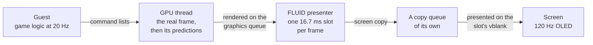

<div align="center">

<picture>
  <source media="(prefers-color-scheme: dark)" srcset="assets/readme/hero.svg">
  
</picture>

**An open-source Nintendo Switch 2 emulator, tuned for the integrated GPU in your laptop or handheld.**<br>
A fork of [Lichii](https://github.com/zortos293/Lichii) (the yuzu, Eden, Eglantine line), GPL-3.0-or-later. Intel Arc first, AMD handhelds next. Every number names its machine.

<a href="https://github.com/karimalsalah/guarana/releases/latest"></a>

<a href="https://github.com/karimalsalah/guarana/releases/latest"></a>
<a href="https://github.com/karimalsalah/guarana/actions/workflows/build-check.yml"></a>
<a href="LICENSE.txt"></a>
<a href="https://discord.gg/urz7vMdRM"></a>
<a href="docs/AI-QUICKSTART.md"></a>

</div>

**Measured, with the machine named.** So far on one laptop: Core Ultra 9 285H, Arc 140T, Intel driver 32.0.101.9175, 120 Hz OLED, in Ocarina of Time's Hyrule Field.

- **Frames on time.** The v20.3 defaults put **599 of 600** display slots on screen on time in the best run, with **0 late flips** and **99.5%** of frames within 2 ms of the median. [Measured wins](#measured-wins)
- **One shader fix: 14.8 to 22.8 game fps**, frame generation off (`EDEN_NX2_GM=11`, on by default for Ocarina of Time only). [Measured wins](#measured-wins)
- **Shaders before you play.** `guarana-cli --warm-pipelines` built 4,515 pipelines and programs in 155 s without booting the game. [docs/warm-up.md](docs/warm-up.md)
- **No compiler needed to help.** CI builds every pull request and posts a Windows test build anyone with the game can run. [Contribute](#contribute-with-or-without-an-ai-agent)

<div align="center">

<picture>
  <source media="(prefers-color-scheme: dark)" srcset="assets/readme/metrics.svg">
  
</picture>

[Get it](#get-it) · [Devices](#devices) · [Test it](#test-it-on-your-device-10-minutes) · [Contribute](#contribute-with-or-without-an-ai-agent) · [Measured wins](#measured-wins) · [How the pacing works](#how-the-frame-pacing-works) · [Roadmap](#roadmap) · [Docs](#docs) · [FAQ](#faq) · [Website](https://karimalsalah.github.io/guarana/)

<sub>**Languages:** English · [简体中文](docs/i18n/README.zh-CN.md) · [Español](docs/i18n/README.es.md) · [Português (Brasil)](docs/i18n/README.pt-BR.md) · [日本語](docs/i18n/README.ja.md) · [한국어](docs/i18n/README.ko.md) · [Français](docs/i18n/README.fr.md) · [Deutsch](docs/i18n/README.de.md) · [Русский](docs/i18n/README.ru.md) · [العربية](docs/i18n/README.ar.md)</sub>

</div>

<sub>No keys, firmware or games included: bring your own, dumped from hardware you own. Not affiliated with Nintendo. [Legal](#legal).</sub>

## Get it

1. **Download** `Guarana-Setup-<version>.exe` from [Releases](https://github.com/karimalsalah/guarana/releases/latest), the only official download. It installs for your user, without admin rights. Linux and macOS builds are there too.
2. **Bring your own keys, firmware and games**, dumped from hardware you own. Guarana Setup finds them on your PC with your consent; in the emulator they are *Tools → Install Decryption Keys* and *Tools → Install Firmware*.
3. **Play.** On a Windows integrated GPU, Ocarina of Time sets up its own frame pacing; on an Intel iGPU without matrix cores, such as the Arc 140T, it also turns frame generation on (since v20.2). The first visit to each area hitches once while shaders compile.

The zip install, every platform, the data folders and the guides: [Install in detail](#install-in-detail). Stuck? [Troubleshooting](docs/TROUBLESHOOTING.md), or ask in the [Discord](https://discord.gg/urz7vMdRM).

## Devices

Guarana is tuned for integrated GPUs: **Intel Arc first, AMD handhelds next, and every Windows PC welcome.** Measured first on the Arc 140T; every other device's numbers come from your reports.

**Windows x64 is the tested platform** (Linux and macOS builds are on Releases, untested on these devices); you need an x86-64 CPU with AVX2 and a Vulkan driver. 16 GB of RAM is below the comfortable floor, because the GPU shares it: with 16 GB, enlarge the page file before the first run ([requirements](docs/DEVICES.md#requirements-v20)).

| GPU | Example devices | Status |
|---|---|---|
| Intel Arc **140T** (Arrow Lake-H) | Core Ultra 9 285H laptops | **Tested.** 14.75 to 22.83 game fps at the Hyrule Field overlook with `EDEN_NX2_GM=11`, frame generation off; 599 of 600 slots on time with the v20.3 defaults ([Measured wins](#measured-wins)) |
| Intel Arc 130T (Arrow Lake-H) | Laptops | Untested: [send a report](https://github.com/karimalsalah/guarana/issues/new?template=device-report.yml) |
| Intel Arc **140V** / 130V (Lunar Lake) | MSI Claw 8 AI+, MSI Claw 7 AI+ | Community report: 22-24 fps in gameplay on a third-party build, not verified by us ([source](docs/DEVICES.md#third-party-data-points)). Untested here: [send a report](https://github.com/karimalsalah/guarana/issues/new?template=device-report.yml) |
| Intel Arc (Meteor Lake) | MSI Claw A1M | Untested: [send a report](https://github.com/karimalsalah/guarana/issues/new?template=device-report.yml) |
| Intel Arc B370 / **B390** (Panther Lake) | MSI Claw 8 EX AI+, other Arc G3 handhelds | Untested: [send a report](https://github.com/karimalsalah/guarana/issues/new?template=device-report.yml) |
| AMD Radeon **780M** | ROG Ally, ROG Ally X, Legion Go | Untested: [send a report](https://github.com/karimalsalah/guarana/issues/new?template=device-report.yml) |
| AMD Radeon **880M / 890M** | ROG Xbox Ally X, Legion Go 2, MSI Claw A8 | Community report: about 30 fps in Ocarina of Time on an 890M, upstream Lichii [issue #1433](https://github.com/zortos293/Lichii/issues/1433), not verified by us. Untested here: [send a report](https://github.com/karimalsalah/guarana/issues/new?template=device-report.yml) |
| AMD Radeon **8060S** (Strix Halo) | | Untested: [send a report](https://github.com/karimalsalah/guarana/issues/new?template=device-report.yml) |
| Steam Deck, Ryzen Z2 A (RDNA2) | | Untested; likely too weak. A report says for sure |
| NVIDIA and other discrete GPUs | | Not a target and not tested here; reports welcome |

*Community reports* are third-party numbers from other builds and scenes. For context, a survey of other Switch 2 forks, as of 2026-11-13, found none claiming more than 26 fps in Hyrule Field on an Intel integrated GPU. Requirements, vendor notes and the device profile line: [docs/DEVICES.md](docs/DEVICES.md). Reports feed the leaderboard on the [benchmarks page](https://karimalsalah.github.io/guarana/benchmarks.html).

## Coming in v20.3

Merged on `main` and listed under [Unreleased](CHANGELOG.md#unreleased) in the changelog; it reaches [Releases](https://github.com/karimalsalah/guarana/releases) with the next version.

- **Frames on time in Ocarina of Time** on Windows integrated GPUs, by default: the screen copy runs on a queue of its own, and the frame budget no longer raises the resolution into the GPU time the cadence frees. The numbers are at the top of this page.
- **FLUID at 120 Hz**, opt-in (`EDEN_NX2_SHOWN_RATE=120`, or a frame generation target of 120): a frame every refresh of a 120 Hz display. In Hyrule Field on the Arc 140T, five swapchain images took slots on time from 790-801 to 1134-1137 of 1200.
- **Fewer freezes.** Pointer-slot compute rebuilds compile on a worker, which removes 2.5-3.4 s freezes in Hyrule Field (upstream [#995](https://github.com/zortos293/Lichii/pull/995)), and guest writes no longer block the game thread when the caches are busy (upstream [#1602](https://github.com/zortos293/Lichii/pull/1602)).
- **A device profile in the log**: GPU, CPU cores, RAM, power, display refresh and a device class, in one line you can paste into a report. No default changes with it yet ([docs/DEVICES.md](docs/DEVICES.md#the-device-profile-in-the-log)).
- **Launcher:** an opt-in three-level [Game Booster](launcher/CONTRACT.md#game-booster) that undoes everything when the game exits, and [Windows integration](launcher/README.md#windows-integration): game files open from Explorer, `guarana://` links, taskbar progress and opt-in notifications.
- **Checkable downloads**: a signed build provenance attestation on every release file ([docs/SIGNING.md](docs/SIGNING.md)).

## Test it on your device (10 minutes)

No code and no debugger. Every GPU except one laptop's Arc 140T is untested, so any report is a first data point. The [call for testers (#55)](https://github.com/karimalsalah/guarana/issues/55) lists the devices needed most.

1. **Install** Guarana Setup, plug in the charger and leave the settings at their defaults (mode **Auto**).
2. **Stand in Hyrule Field** in your own copy of Ocarina of Time: 30 seconds to settle, then one more minute. Take one screenshot.
3. **Send it.** Press **Share** on the card the launcher shows after the game (it fills in your device, driver and numbers), or fill in the [device report form](https://github.com/karimalsalah/guarana/issues/new?template=device-report.yml). You read it and you press Submit; nothing is sent for you.

"It does not run" and "it crashes here" are results too. Leave out keys, firmware, games, saves, shader caches and logs with your name in them. The full protocol: [docs/TESTING.md](docs/TESTING.md). To measure with scripts and set a record on the [records board](https://karimalsalah.github.io/guarana/benchmarks.html#records): [docs/BENCHMARKING.md](docs/BENCHMARKING.md).

## Contribute, with or without an AI agent

The rules are the same for people and agents ([AGENTS.md](AGENTS.md)), and a person owns every pull request.

1. **Find work.** [Good first issues](https://github.com/karimalsalah/guarana/issues?q=is%3Aissue%20is%3Aopen%20label%3A%22good%20first%20issue%22), [help wanted](https://github.com/karimalsalah/guarana/issues?q=is%3Aissue%20is%3Aopen%20label%3A%22help%20wanted%22), and [agent-ready tasks](https://github.com/karimalsalah/guarana/issues?q=is%3Aissue%20is%3Aopen%20label%3Aagent-ready%20-label%3Aneeds-triage%20no%3Aassignee), each with an acceptance test. Open problems with their numbers: [Open wins](https://karimalsalah.github.io/guarana/wins.html).
2. **Claim it.** Comment `/claim` on the issue: the bot labels it `claimed` and assigns you, so nobody else starts the same work. The claim holds for 72 hours, and for as long as an open pull request links the issue; `/unclaim` gives it back ([how claims work](docs/agents/README.md#2-claim-it)).
3. **Do it, with an agent or by hand.** By hand: [CONTRIBUTING.md](CONTRIBUTING.md#five-minute-start). With an agent, one sentence in your clone, here with Claude Code ([every tool](#built-for-ai-agents)):

   ```text
   claude "Read AGENTS.md, then fix https://github.com/karimalsalah/guarana/issues/<n>"
   ```

4. **Open the pull request.** CI builds it on Linux and Windows and comments a Windows test build. Disclose AI help with an `Assisted-by:` trailer ([docs/AI_POLICY.md](docs/AI_POLICY.md)). Once merged, your name goes on the [Hall of fame](#hall-of-fame).

Questions get answers in the [Discord](https://discord.gg/urz7vMdRM); bugs and device reports stay on GitHub.

<a name="measured-results"></a>

## Measured wins

<picture>
  <source media="(prefers-color-scheme: dark)" srcset="assets/readme/pacing.svg">
  
</picture>

Every number in this section comes from one laptop: **Core Ultra 9 285H, Arc 140T iGPU, Intel driver 32.0.101.9175, 120 Hz OLED**, 32 GB RAM. Game: *The Legend of Zelda: Ocarina of Time*. A slot is one 16.7 ms display interval, two refreshes at 120 Hz, so 10 s hold 600. **Game fps** counts the frames the game renders; generated frames are not included.

**The v20.3 result.** In Hyrule Field the v20.3 defaults put **599 of 600** display slots on screen on time in the best run, with **0 late flips** and **99.5%** of frames within 2 ms of the median. Over two paired rounds: 531-599 of 600, 0 late flips. The old setup put only about 45-47% of frames on screen on time.

**What v20.3 fixed.** In the old setup the screen copy waited behind about 24 ms of queued game GPU work, so about 200 frames per 10 s were flipped late. v20.3 copies each frame to the screen on a queue of its own and stops the frame budget from raising the resolution into the freed GPU time. Real frames hold 20 a second against the game's 20 Hz logic. The switches behind it: [How the frame pacing works](#how-the-frame-pacing-works).

**How it was measured.** The old setup and the v20.3 defaults ran back to back in two paired rounds in Hyrule Field. The presenter counts the slots shown on time and the late flips (frames whose screen copy finished after their vblank) every 10 s; `EDEN_NX2_SHOWN_STATS` gives the share of frames within 2 ms of the median ([docs/switches.md](docs/switches.md)). No input latency figure is published yet. [Help us measure](docs/BENCHMARKING.md); live data is on the [benchmarks page](https://karimalsalah.github.io/guarana/benchmarks.html).

<details>
<summary><b>Earlier measured wins: v20 and v20.1</b></summary>

| Win | Before | After | Status |
|---|---:|---:|---|
| Hyrule Field, from one shader fix (`EDEN_NX2_GM=11`), frame generation off | 14.8 game fps | **22.8 game fps** | Since v20; on by default for Ocarina of Time only |
| Foliage mesh draw, same runs | 15.7 ms GPU | **5.8 ms GPU** | Since v20 |
| Frame generation pacing, title screen: frames within 2 ms of the median | n/a | **100%** (16.7 ms pacing) | In v20.1, opt-in (`EDEN_NX2_FLUID=1`) |
| Same measure, Hyrule Field | 33-54% | **75%** (p5 16.4 ms) | In v20.1, opt-in (`EDEN_NX2_FLUID=1`) |
| Headless shader warm-up | n/a | **4,515 pipelines in 155 s** | Since v20.1 (`guarana-cli --warm-pipelines`, `eden-cli` before v20.2) |

The shader fix is a same-spot A/B at the Hyrule Field overlook, switch on against off, plugged in: 14.75 against 22.83 game fps. The v20.1 pacing rows come from `EDEN_NX2_SHOWN_STATS`, which reports every 10 s how evenly frames reached the swapchain, generated ones included.

</details>

<a name="ai-native-plug-in-your-agent"></a>

## Built for AI agents

Point an agent at an issue and it finds everything it needs here: one rulebook, [AGENTS.md](AGENTS.md); tasks written with an acceptance test; a free test build for every pull request; and, when a tester runs the game, a debug server it can ask for frame times and screenshots. The agent does the work end to end. A person owns the pull request.

**Start in one line.** Fork, clone, start your tool in the folder and give it one sentence:

| Tool | One command in your clone |
|---|---|
| **Claude Code** | `claude "Read AGENTS.md, then fix https://github.com/karimalsalah/guarana/issues/<n>"` (`CLAUDE.md` imports `AGENTS.md`) |
| **OpenAI Codex CLI** | `codex "Read AGENTS.md, then fix https://github.com/karimalsalah/guarana/issues/<n>"` (trust the folder so `.codex/config.toml` lifts Codex's 32 KiB cap on `AGENTS.md`, or add `-c project_doc_max_bytes=65536`) |
| **Gemini CLI** | `gemini`, then paste the sentence (`GEMINI.md` imports `AGENTS.md`) |
| **Cursor** | `agent "Read AGENTS.md, then fix ..."`, or open the folder (`.cursor/rules/guarana.mdc` is always on) |
| **GitHub Copilot** | Agent mode in your editor, or the coding agent from your fork; paste the sentence |
| **Windsurf** | Open the folder, open Cascade, paste the sentence |
| **Aider** | `aider --message "Read AGENTS.md, then fix ..."` (`.aider.conf.yml` loads `AGENTS.md`) |
| **Cline** | `cline "Read AGENTS.md, then fix ..."`, or the extension (`.clinerules/` and `AGENTS.md`) |

No install? Paste the [copy-paste prompt](docs/AI-QUICKSTART.md#no-install-chatgpt-claude-or-gemini-in-the-browser) into ChatGPT, Claude or Gemini in the browser. It points the chat at [`llms-full.txt`](https://karimalsalah.github.io/guarana/llms-full.txt), the whole project context in one URL; the site's [agents page](https://karimalsalah.github.io/guarana/agents.html) has a copy button. Install steps, flags and the honest limits of each tool: [docs/AI-QUICKSTART.md](docs/AI-QUICKSTART.md).

**What an `agent-ready` issue holds.** Each one comes from the [agent task form](https://github.com/karimalsalah/guarana/issues/new?template=agent-task.yml): the goal, the files to change and what to read first, an acceptance test that fails before the change and passes after it, the measurement (scene, device, metric, baseline and the gain that counts, or "not a performance task"), whether it can be checked without the game, and its size. Triage adds `agent-ready` when the acceptance test is checkable, and new ones get a **"Solve it with AI"** comment with the commands above filled in. [Open and unclaimed](https://github.com/karimalsalah/guarana/issues?q=is%3Aissue%20is%3Aopen%20label%3Aagent-ready%20-label%3Aneeds-triage%20no%3Aassignee): 46 as of 2026-11-13.

**Claim it, so two agents do not do the same work.** Take an issue without `needs-triage` and without an assignee. Read it and its comments, and check that nobody has claimed it: an assignee, a `claimed` label, a linked pull request. Then comment `/claim`: the `agent-claims` workflow labels it `claimed` and assigns you, and a claim with no open pull request linking the issue is released after 72 hours. If you stop, comment `/unclaim`. Stay inside its scope; anything else is a new issue. The long form: [CONTRIBUTING.md](CONTRIBUTING.md#picking-an-agent-ready-issue), [docs/AGENTS-INVITE.md](docs/AGENTS-INVITE.md), [docs/agents/README.md](docs/agents/README.md) and [HANDOVER.md](HANDOVER.md).

**See and drive the game.** `.mcp.json` registers the `emulator-debug` MCP server ([docs/nx2/debug-mcp.md](docs/nx2/debug-mcp.md)). When a tester starts a build with `EDEN_NX2_DEBUG_SERVER=127.0.0.1:6545`, the agent reads frame times, screenshots, GPU costs and logs, A/B tests shaders and sends controller input. Loopback only; the agent never starts or stops the emulator.

**No compiler needed.** CI builds every pull request on Linux and Windows and comments a Windows test build (`guarana-pr<N>-<commit>-windows-x86_64`, kept 14 days) that anyone with the game can run.

**Rules that keep it honest.** Measured gains only, default-off `EDEN_NX2_*` switches, no game data. The person who runs the agent owns the pull request and discloses the AI with an `Assisted-by:` trailer ([docs/AI_POLICY.md](docs/AI_POLICY.md)). Every merged pull request puts its author on the [Hall of fame](#hall-of-fame).

## Why contribute now

- **It is early.** One device has results, the Arc 140T. Almost any laptop or handheld you own is a first data point, and a [device report](https://github.com/karimalsalah/guarana/issues/new?template=device-report.yml) needs no code.
- **Open problems have numbers.** Read-back stalls, first-visit shader stutter, boot time, Hyrule Field fps and the first AMD reports are on the [Open wins](https://karimalsalah.github.io/guarana/wins.html) page, each with its scene, today's number and target.
- **Your name stays.** Every merged pull request, and every `Co-authored-by:` trailer, goes on the [Hall of fame](#hall-of-fame) and in [CONTRIBUTORS.md](CONTRIBUTORS.md), rebuilt daily from the git history.
- **Help in real time.** Questions about a task, a driver or a build get answers in the [Discord](https://discord.gg/urz7vMdRM). Bugs and device reports stay on GitHub so they can be tracked.
- **Small steps count.** Run the [benchmark](docs/BENCHMARKING.md), triage an issue, port an upstream fix with its author credited, add a test. [CONTRIBUTING.md](CONTRIBUTING.md) has the five-minute start.

## Hall of fame

Everyone credited for good. Authors of merged commits and of `Co-authored-by:` trailers are people; bots and AI tools are
listed apart as tools. Rebuilt daily by [`tools/ci/legacy.py`](tools/ci/legacy.py).

<!-- legacy:start -->
<!-- Generated by tools/ci/legacy.py. Do not edit between the markers. -->

<p align="center">
  <a href="https://github.com/cerroverb"></a>
  <a href="https://github.com/danieljesus"></a>
  <a href="https://github.com/jpkto"></a>
  <a href="https://github.com/karimalsalah"></a>
  <a href="https://github.com/Nanoc6"></a>
  <a href="https://github.com/PantACRO4life"></a>
  <a href="https://github.com/zortos293"></a>
</p>

**8 people credited for good**, 1 of them not shown here. Everyone: [CONTRIBUTORS.md](CONTRIBUTORS.md) and the [Hall of fame](https://karimalsalah.github.io/guarana/legacy.html).

<!-- legacy:end -->

<a name="quick-start"></a>
<a name="play-ocarina-of-time-on-your-pc"></a>

## Install in detail

> [!NOTE]
> **Guarana Setup** (since v20.1), the Windows installer and launcher, about 92 MB with WebView2 included, one click:
> - **One switch** for how it runs: Auto, Smooth, Quality or Battery.
> - **Finds your own keys, firmware and games** on your own PC, with your consent, and sets up your controller automatically.
> - **Autopilot** retunes after each session, with undo.
> - **Doctor** finds common problems and offers fixes.
> - **"Ask AI" buttons** open a prefilled Claude or ChatGPT chat with scrubbed diagnostics (you press send).
>
> Download `Guarana-Setup-<version>.exe` from [Releases](https://github.com/karimalsalah/guarana/releases/latest). Prefer no installer? The zip below is the whole install.

**[Releases](https://github.com/karimalsalah/guarana/releases/latest)** is the only official download, for every platform:
Windows x86-64 zips (plain and PGO), Linux x86-64 and ARM64 (AppImage and tar.gz, plain and PGO), macOS Apple silicon (dmg and zip),
and `SHA256SUMS.txt` to check them ([how to verify a download](docs/SIGNING.md), build provenance and signatures included). Our own numbers on this page were measured on Windows, with a CPU with AVX2 and a current GPU driver.

1. **Download** the build for your system from [Releases](https://github.com/karimalsalah/guarana/releases/latest). To build it yourself: [docs/Build.md](docs/Build.md), or one command: `powershell -ExecutionPolicy Bypass -File scripts\build-windows.ps1` / `bash scripts/build-linux.sh`.
2. **Extract** it to a writable folder and run **`guarana.exe`**.
3. **Install your keys and firmware:** *Tools → Install Decryption Keys*, then *Tools → Install Firmware*.
4. **Add your games folder** (double-click the empty game list) and start a game. Each new area compiles shaders and hitches once; later visits use the cache. `guarana-cli --warm-pipelines <title id>` builds the cached ones ahead of time ([docs/warm-up.md](docs/warm-up.md)).
5. **Ocarina of Time:** on a Windows integrated GPU the game's preset does the setup (since v20.2). It sets the pacing switches in [the table below](#how-the-frame-pacing-works), and on an Intel iGPU without matrix cores, such as the Arc 140T, it also turns frame generation on (multiplier 3, target 60). It changes only what you left at its default. Elsewhere, or by hand: *Emulation → Configure… → Graphics → Enable Frame Generation*, **Frame Generation Multiplier** 3, **Target Frame Rate** 60. Measured on the Arc 140T only.

Settings, saves and caches live in `%APPDATA%\guarana`. On first start Guarana copies your settings, saves and caches from the old `%APPDATA%\lichii` folder and points the copied settings at the new one; the old folder stays as it was. On Linux the folder is `guarana` in your config directory (`$XDG_CONFIG_HOME/guarana`).
Put your own switch lines in `%APPDATA%\guarana\nx2_switches.txt`, not the copy next to `guarana.exe`; a play mode writes its own block at the top of that file ([docs/user/ui.md](docs/user/ui.md)). Every switch is in [docs/switches.md](docs/switches.md).

**Guides:** [play Ocarina of Time on a PC in five minutes](https://karimalsalah.github.io/guarana/play-ocarina-of-time-switch-2-on-pc.html) · [Intel Arc settings](https://karimalsalah.github.io/guarana/switch-2-emulator-intel-arc.html) · [stutter, black screen, crash](https://karimalsalah.github.io/guarana/fix-stutter-switch-2-emulator.html) · [ROG Ally, Legion Go, MSI Claw, Steam Deck](https://karimalsalah.github.io/guarana/switch-2-emulator-handheld.html) · [controllers](https://karimalsalah.github.io/guarana/controller-setup.html) · [emulator or recompilation](https://karimalsalah.github.io/guarana/play-ocarina-of-time-switch-2-on-pc.html#compare). For Ocarina of Time: the [controller guide](docs/user/Controllers.md), the [Dynamic FPS add-on](docs/nx2/ocarina-dynamic-fps.md) and the [anti-aliasing network bypass](docs/nx2/oot-network-bypass.md).
Stuck? [Troubleshooting](docs/TROUBLESHOOTING.md), or ask in the [Discord](https://discord.gg/urz7vMdRM).

<details>
<summary><b>What v20.2 brought</b></summary>

- **The Guarana name.** The programs are `guarana.exe` and `guarana-cli.exe` (`lichii.exe` and `eden-cli.exe` before), the data folder is `%APPDATA%\guarana`, and your old folder is copied as described above. The first boot after the rename recompiles shaders once, because Intel's driver cache is per program name.
- **A new window.** The Guarana Dark theme, a Guarana settings page with three play modes (Smooth, Quality, Battery), a compact performance overlay and window memory per monitor ([docs/user/ui.md](docs/user/ui.md)).
- **Ocarina of Time smooth out of the box** on Windows integrated GPUs (step 5 above).
- **Upstream Lichii build-177**, merged.

Full notes: [CHANGELOG.md](CHANGELOG.md).

</details>

## How the frame pacing works

The game renders **real frames** at its own pace, and frame generation fills the display slots between them. In Ocarina of Time those frames are **predicted**: the newest real frame's pixels move along the game's motion vectors, depth decides which surface is in front, and the HUD stays in place. Extrapolation shows each real frame as soon as it is ready, where interpolation would hold it back until the next one exists. Generated frames make motion smoother, not input faster.



Before v20.3 the screen copy shared the graphics queue and waited behind the game's queued work. Now it runs on a queue of its own at default priority, beside the game's rendering, and the present thread waits for the copy to finish before it presents. The frame budget now only lowers the resolution: raising it into the GPU time the cadence frees would keep the GPU queue deep.

**v20.3 defaults for Ocarina of Time on a Windows integrated GPU.** The game's preset sets them, only where you left them at their defaults; `EDEN_NX2_NO_PRESETS=1` or *Automatic presets* off turns it off.

| Switch or setting | Value | What it does |
|---|---|---|
| Frame generation | 3x toward 60 | Each real frame fills three 16.7 ms slots. The preset turns it on for Intel iGPUs without matrix cores, such as the Arc 140T; elsewhere turn it on yourself |
| `EDEN_NX2_EXTRAPOLATE` | `1` | Predicts frames from the game's motion vectors |
| `EDEN_NX2_FLUID` | `2` | The vblank-locked presenter: the real frame is shown, and predictions reach under one frame interval ahead |
| `EDEN_NX2_CADENCE` | `3` | 20 real frames a second, one per game tick, so predicted motion has the right speed |
| `EDEN_NX2_FLUID_QUEUE`, `EDEN_NX2_FLUID_QUEUE_HOST_WAIT` | `5`, `1` | New in v20.3: the screen copy on a queue of its own at default priority, and the present thread waits for it |
| `EDEN_NX2_BUDGET_HOLD_RES` | `1` | New in v20.3: the frame budget only lowers the resolution, so it cannot fill the GPU time the cadence frees |
| `EDEN_NX2_EARLY_SUBMIT`, `EDEN_NX2_EARLY_PAGES`, `EDEN_NX2_EARLY_AFTER` | `1`, `256`, `1` | Early read-backs |
| `EDEN_NX2_GPL` | `1`, Intel only | Pipeline library fast links for first-visit shaders |

Every row, with its measurements and code: [docs/switches.md](docs/switches.md). Contributor detail: [docs/frame-generation.md](docs/frame-generation.md) and [docs/ARCHITECTURE.md](docs/ARCHITECTURE.md#frame-generation-and-pacing).

<details>
<summary><b>Why frames looked uneven before the presenter</b></summary>

<p align="center">
<picture>
  <source media="(prefers-color-scheme: dark)" srcset="assets/readme/frametime.svg">
  
</picture>
</p>

A real frame that lands between two refreshes cannot stay up as long as the one before it, so motion looks uneven even at a steady average. The FLUID presenter shows one frame per 16.7 ms slot instead, timed to the slot's vblank.

</details>

## Roadmap

**Planned next** (no dates yet): **per-device defaults.** v20.3 logs a device class at boot; a default for a class comes only with a paired run on a verified scene of that class ([docs/DEVICES.md](docs/DEVICES.md#the-device-profile-in-the-log)). The Game Booster, signed build provenance and the Windows integrations that were on this list are in v20.3 ([Coming in v20.3](#coming-in-v203)).

**Open in [ROADMAP.md](ROADMAP.md)**, each item with a problem, a plan and a definition of done: the Intel pipeline-cache crash ([IGCIT #1614](https://github.com/IGCIT/Intel-GPU-Community-Issue-Tracker-IGCIT/issues/1614)), shader translation off the GPU thread, persisted SPIR-V, non-blocking boot and memory-mapped caches, cheaper Intel pipeline compiles, the AMD Radeon iGPU path, disocclusion fill for predicted frames and shader-need prediction. Later: LSE atomics in the JIT, handheld mode and hotkeys, portable mode out of the box, and auto-update. What already shipped: [CHANGELOG.md](CHANGELOG.md).

## Docs

| Document | What it is |
|---|---|
| [docs/README.md](docs/README.md) | Every document, one line each |
| [docs/FAQ.md](docs/FAQ.md) | Short answers: legality, frame generation, hitches, settings, updates |
| [docs/TROUBLESHOOTING.md](docs/TROUBLESHOOTING.md) | Start-up errors, hitches, pacing problems and crashes |
| [docs/switches.md](docs/switches.md) | Every `EDEN_NX2_*` switch: values, status, measured effect, code |
| [docs/frame-generation.md](docs/frame-generation.md) | How frames are predicted and paced, the known limits, and how to test them |
| [docs/TESTING.md](docs/TESTING.md), [docs/DEVICES.md](docs/DEVICES.md) | The 10-minute device test; requirements and every device's status |
| [AGENTS.md](AGENTS.md) | The rulebook for agents and people: rules, repository map, build, verification |
| [CONTRIBUTING.md](CONTRIBUTING.md) | How to contribute, in order |
| [ROADMAP.md](ROADMAP.md) | Open work, each item with a problem, a plan and a definition of done |
| [docs/agents/README.md](docs/agents/README.md), [HANDOVER.md](HANDOVER.md) | For agents: claiming work and avoiding collisions |
| [CHANGELOG.md](CHANGELOG.md), [CREDITS.md](CREDITS.md) | What shipped in each version; whose work Guarana builds on |

## FAQ

- **Is this legal?** Guarana contains no keys, firmware, games or system files; you use your own dumps. [LEGAL.md](LEGAL.md), [FAQ](docs/FAQ.md#is-this-legal).
- **Does frame generation make the game faster?** It makes motion smoother; the game still runs and reads input at its own rate. [More](docs/FAQ.md#does-frame-generation-make-the-game-faster).
- **Does it add input lag?** Extrapolation never holds a real frame back the way interpolation does; a measured latency figure is not published yet. [More](docs/FAQ.md#does-frame-generation-add-input-lag).
- **Why 20 real frames a second?** By design. Ocarina of Time's logic runs at 20 Hz, so one real frame per game tick gives predicted frames the right speed, and the presenter fills the slots between them. [How the frame pacing works](#how-the-frame-pacing-works).
- **Why does it hitch the first time I enter an area?** The driver is compiling shaders, 0.4-1 s per pipeline on Intel; later visits use the cache. [More](docs/FAQ.md#why-does-it-hitch-the-first-time-i-enter-an-area).
- **Will it run on my device?** Try it, then send a [device report](https://github.com/karimalsalah/guarana/issues/new?template=device-report.yml): your numbers put your device on the leaderboard. [Devices](#devices).
- **Do I have to use AI to contribute?** No. The rules are the same for people and agents. [CONTRIBUTING.md](CONTRIBUTING.md).

All questions: [docs/FAQ.md](docs/FAQ.md). Every document: [the docs index](docs/README.md). Chat: [discord.gg/urz7vMdRM](https://discord.gg/urz7vMdRM).

## Legal

> [!IMPORTANT]
> - **No keys, firmware, games or system files** are included, and none are accepted in issues, pull requests, discussions or the Discord.
> - **No piracy.** Requests for or links to copyrighted files are closed without discussion.
> - **Optional LSFG frame generation** only loads a `Lossless.dll` that you supply from your own Lossless Scaling purchase. Guarana distributes none of it.
> - **Independent project.** Not affiliated with, endorsed by or sponsored by Nintendo, or by the Lichii project. "Nintendo" and "Nintendo Switch" are trademarks of Nintendo, used only to say what this software is compatible with. Games are named in plain text to identify test cases; this README uses no game screenshots or Nintendo artwork.
>
> Full text: [LEGAL.md](LEGAL.md).

## Credits and license

Guarana stands on [Lichii](https://github.com/zortos293/Lichii), [Eglantine](https://github.com/Eglantine-Community/Eglantine),
[Eden](https://git.eden-emu.dev/eden-emu/eden) and yuzu. The Intel Arc fixes in v20 are ported from
[Fritchii-Intel-Fixes](https://github.com/LuckyLuckLucky/Fritchii-Intel-Fixes). v20.3 carries upstream pull requests
[#1602](https://github.com/zortos293/Lichii/pull/1602), [#995](https://github.com/zortos293/Lichii/pull/995),
[#1584](https://github.com/zortos293/Lichii/pull/1584) and [#1483](https://github.com/zortos293/Lichii/pull/1483), which
upstream had not merged when we took them. Everyone who contributed upstream, the authors of every pull request we carry
included: [CREDITS.md](CREDITS.md). Everyone who contributed here: [CONTRIBUTORS.md](CONTRIBUTORS.md). Free software under
the **GNU General Public License v3.0 or later** ([LICENSE.txt](LICENSE.txt)).
