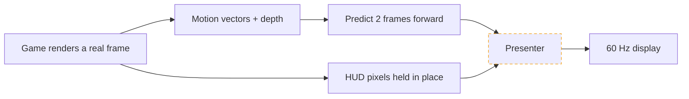

<div align="center">

<picture>
  <source media="(prefers-color-scheme: dark)" srcset="assets/readme/hero.svg">
  
</picture>

**A free, open-source Nintendo Switch 2 emulator for Windows, tuned for the integrated GPU in your laptop or handheld.**

<a href="https://github.com/karimalsalah/guarana/releases/latest"></a>

<a href="https://github.com/karimalsalah/guarana/releases/latest"></a>
<a href="https://github.com/karimalsalah/guarana/releases"></a>
<a href="https://github.com/karimalsalah/guarana/actions/workflows/build-check.yml"></a>
<a href="LICENSE.txt"></a>
<a href="https://github.com/karimalsalah/guarana/stargazers"></a>
<a href="https://github.com/karimalsalah/guarana/discussions"></a>
<a href="AGENTS.md"></a>

[Quick start](#quick-start) · [Why Guarana](#why-guarana) · [Ocarina of Time](#play-ocarina-of-time-the-best-way-on-pc) · [Frame pacing](#how-the-frame-pacing-works) · [Devices](#devices) · [Contribute](#contribute-in-5-minutes) · [Roadmap](#roadmap) · [FAQ](#faq) · [Website](https://karimalsalah.github.io/guarana/)

</div>

> [!IMPORTANT]
> Guarana ships **no keys, firmware, games or system files**. You bring your own, dumped from a
> console and games you own. Not affiliated with Nintendo or with the Lichii project. See [Legal](#legal).

Guarana is a fork of [Lichii](https://github.com/zortos293/Lichii) (`nx2` branch, descended from
Eglantine, Eden and yuzu), GPL-3.0-or-later. It follows upstream and adds what machines with shared-memory
graphics need: Intel Arc driver fixes, cheaper shaders in heavy scenes, frame generation that predicts
frames instead of waiting for them, and a contributor harness built for humans and AI agents. Intel Arc
laptops and handhelds come first, AMD Radeon 780M/890M handhelds next. Every number in this README names
the machine it came from.

## Quick start

**Today (v20.0.2): a zip.** Windows x64, a CPU with AVX2, a current GPU driver, and your own keys, firmware and games.

1. **Download** the zip from [Releases](https://github.com/karimalsalah/guarana/releases/latest), the only official download. Linux and macOS builds come from CI, or build from source: [docs/Build.md](docs/Build.md).
2. **Extract** it to a writable folder and run **`lichii.exe`** (v20 keeps the upstream program name).
3. **Install your keys and firmware:** *Tools → Install Decryption Keys*, then *Tools → Install Firmware*.
4. **Add your games folder** (double-click the empty game list) and start a game. Each new area compiles shaders and hitches once; later visits use the cache.
5. **Optional, for Ocarina of Time:** turn on frame generation, see [the play config below](#play-ocarina-of-time-the-best-way-on-pc).

> [!NOTE]
> **Coming in v20.1, not shipped yet:** a one-click `Setup.exe` and the Guarana Launcher that finds your
> keys, firmware and games on your own disk (with your consent) and picks a profile for your device.
> [What is planned](#coming-in-v201). Until then, steps 1-4 above are the whole install.

Settings, saves and caches live in `%APPDATA%\lichii`, **the same folder upstream Lichii uses**: back it up
before switching between the two. Stuck? [Troubleshooting](docs/TROUBLESHOOTING.md).

## Why Guarana

Measured on one laptop: Core Ultra 9 285H, **Arc 140T** iGPU, Intel driver 32.0.101.9175, 32 GB RAM,
*The Legend of Zelda: Ocarina of Time*. **Game fps** counts frames the game renders; generated frames are not included.

- **Hyrule Field 14.8 → 22.8 game fps** with global-memory routing (`EDEN_NX2_GM=11`), frame generation off, same spot, switch off vs on.
- **Foliage draw 15.7 → 5.8 ms** of GPU time in those same runs.
- **Frame-generation play config: from locked 50 ms frames (19.6 fps) to about 26.7 fps** live in Castle Town (28 in the field). A live reading, not a same-spot A/B, so read it as a direction.
- **Frame generation that extrapolates** from the game's motion vectors: each real frame is shown as soon as it is ready, with no interpolation hold-back, and the HUD stays steady.
- **Tuned builds:** clang-cl ThinLTO plus PGO, x86-64-v3 code.
- **Upstream first:** tracks Lichii `nx2`, merged 10 upstream PRs early, ported 3 Intel Arc fixes ([changelog](CHANGELOG.md)).
- **Honest by rule:** a gain ships only with a paired A/B on a verified scene ([AGENTS.md](AGENTS.md)). One laptop is one data point, not a promise.

<details>
<summary><b>The full measured table, and what is not measured yet</b></summary>

| What changed | Before | After | How it was measured |
|---|---:|---:|---|
| `EDEN_NX2_GM` off → `=11`, frame generation off | 14.75 game fps | **22.83 game fps** | Hyrule Field overlook, same spot, switch on vs off |
| GPU time of the foliage mesh draw, same runs | 15.7 ms | **5.8 ms** | Same spot, switch on vs off |
| Play config (frame generation 3x toward 60): earlier unreleased build → v20 | 19.6 game fps, locked at 50 ms frames | **26.7** game fps in Castle Town, **28** in the field | Live readings, **not a same-spot A/B** |

No figure for frames shown per second and no input-latency measurement are published yet, because
none has been taken the same way. [Help us measure](docs/BENCHMARKING.md). Live data: the
[benchmarks page](https://karimalsalah.github.io/guarana/benchmarks.html).

</details>

## Play Ocarina of Time the best way on PC

Guarana's first-class game is *The Legend of Zelda: Ocarina of Time*: the preset, the profile for the
PGO build, and the measurements are all there. Bring your own copy.

- **Controller.** Plug in a pad and map it in *Emulation → Configure… → Controls* ([controller guide](docs/user/Controllers.md)). Automatic setup for Xbox, PlayStation, Switch Pro and 8BitDo pads is [coming in v20.1](#coming-in-v201).
- **Frame generation.** *Emulation → Configure… → Graphics → Enable Frame Generation*, **Frame Generation Multiplier** 3, **Target Frame Rate** 60. Extrapolation (`EDEN_NX2_EXTRAPOLATE=1`) is on in the shipped `nx2_switches.txt`.
- **Presets.** `EDEN_NX2_GM=11` turns itself on for this game only, the one title it is verified in. Try it elsewhere by adding it to your own `nx2_switches.txt`; set `EDEN_NX2_GM=0` if a game renders wrong, and [report it](https://github.com/karimalsalah/guarana/issues/new/choose).
- **Power budget (opt-in).** `EDEN_NX2_POWER_POLICY=igpu` hands more of the shared laptop power budget to the iGPU while a game runs, then restores your Windows power plan on exit. Experimental, not measured yet.
- **Extras.** [Dynamic FPS add-on](docs/nx2/ocarina-dynamic-fps.md) and the [anti-aliasing network bypass](docs/nx2/oot-network-bypass.md).

> [!TIP]
> Put your own switch lines in `%APPDATA%\lichii\nx2_switches.txt`, not the copy next to `lichii.exe`: that
> one holds shipped defaults. A variable in the real environment wins over both. Every switch is in
> [docs/switches.md](docs/switches.md).

## How the frame pacing works

<p align="center">
  
</p>

A game renders **real frames** at its own pace. Frame generation adds frames between them so a 60 Hz
display gets a new image on every refresh. In Ocarina of Time those frames are **predicted**: the newest
real frame's pixels move along the game's motion vectors, with depth deciding which surface is in
front. Interpolation must hold a real frame back until the next exists; extrapolation shows each real
frame as soon as it is ready.



> [!NOTE]
> The dashed box is the honest part. At v20's 26.7-28 game fps a real frame arrives every 36-37 ms: more
> than two 16.67 ms refreshes, fewer than three. Shown frames cannot all stay up for the same time,
> which you may see as **micro-stutter**. The fix in progress is a presenter locked to the display's
> vblank (`EDEN_NX2_FLUID=1`, experimental, [ROADMAP N1](ROADMAP.md#n1-vblank-locked-presenter-for-generated-frames)).
> It is not shipped. Generated frames also make motion smoother, not input faster.

```mermaid
---
displayMode: compact
---
gantt
    title 20 game fps, 60 Hz display, 3x frame generation. One step = one refresh = 16.67 ms
    dateFormat X
    axisFormat %-S
    todayMarker off
    section Game
    Real frame 1 :done, 0, 3
    Real frame 2 :done, 3, 6
    Real frame 3 :done, 6, 9
    section Display
    Real 1    :active, 0, 1
    Predicted :1, 2
    Predicted :2, 3
    Real 2    :active, 3, 4
    Predicted :4, 5
    Predicted :5, 6
    Real 3    :active, 6, 7
    Predicted :7, 8
    Predicted :8, 9
```

<details>
<summary><b>A worked example at 20 game fps</b></summary>



Other games use the upstream interpolation path (**Frame Generation Type** in the same settings page).
Contributor details: [docs/ARCHITECTURE.md](docs/ARCHITECTURE.md#frame-generation-and-pacing).

</details>

## Coming in v20.1

> [!IMPORTANT]
> Everything in this section is **planned or in progress, not in the v20.0.2 zip.** Dates are not promised;
> see the [changelog](CHANGELOG.md) for what actually shipped.

| Feature | What it will do |
|---|---|
| **Guarana Launcher and one-click `Setup.exe`** | Detects your device, finds your keys, firmware and games on your own disk (with consent), picks a profile, runs a **doctor** with one-click fixes, updates with checksums. Cinematic UI with controller navigation |
| **Controller auto-configuration** | Plug in an Xbox, PlayStation, Switch Pro or 8BitDo pad and play |
| **Faster boot** | About 11 s of Vulkan start-up is being cut |
| **Vblank-locked presenter** | Even 16.67 ms generated-frame pacing, in progress ([N1](ROADMAP.md#n1-vblank-locked-presenter-for-generated-frames)) |
| **In-app "Report a problem"** | Send a bug or device report without leaving the app |

## Devices

Guarana is for integrated GPUs. **One device is tested so far**; the rest are waiting for you.
[Send a device report](https://github.com/karimalsalah/guarana/issues/new?template=device-report.yml): it feeds the leaderboard on the [site](https://karimalsalah.github.io/guarana/).

| GPU | Example devices | Status |
|---|---|---|
| Intel Arc **140T** (Arrow Lake-H) | Core Ultra 9 285H laptops |  |
| Intel Arc **140V** (Lunar Lake) | MSI Claw 8 AI+ | [](docs/DEVICES.md#third-party-data-points) 22-24 fps, third-party build |
| Intel Arc, Meteor Lake | MSI Claw A1M | [](https://github.com/karimalsalah/guarana/issues/new?template=device-report.yml) |
| Intel Arc **B390** (Panther Lake) | Arc G3 handhelds | [](https://github.com/karimalsalah/guarana/issues/new?template=device-report.yml) |
| AMD Radeon **780M** | ROG Ally | [](https://github.com/karimalsalah/guarana/issues/new?template=device-report.yml) |
| AMD Radeon **880M / 890M** | ROG Xbox Ally X, Legion Go 2 | [](docs/DEVICES.md#third-party-data-points) about 30 fps on 890M, upstream issue |
| AMD Radeon **8060S** (Strix Halo) | | [](https://github.com/karimalsalah/guarana/issues/new?template=device-report.yml) |
| Steam Deck (RDNA2) | | [](https://github.com/karimalsalah/guarana/issues/new?template=device-report.yml) likely too weak |

*Community reports* are third-party numbers with other builds and scenes; **we have not verified them.**
16 GB devices are below the comfortable floor (Switch 2 titles use a 12 GiB guest memory layout).
Requirements and vendor notes: [docs/DEVICES.md](docs/DEVICES.md).

## How Guarana compares

| | **Guarana** | Upstream Lichii | Static-recompilation projects (in general) |
|---|---|---|---|
| Scope | Runs Switch 2 titles as upstream does; coverage tracks `nx2` | Runs Switch 2 titles | One game per project, by design |
| Tuned for iGPUs | Yes: Intel Arc first (only the Arc 140T is tested), AMD Radeon next | General purpose | Varies by project |
| Frame generation without added latency | Extrapolation for Ocarina of Time, experimental; latency not yet measured | Interpolation path | Varies by project |
| One-click installer + doctor | Coming in v20.1 | Zip download | Varies by project |
| Agent-friendly contributing | `AGENTS.md`, `agent-ready` issues, debug MCP server, CI test build per PR | Has its own `AGENTS.md` | Varies by project |
| Ships keys, firmware or games | No | No | No: you supply your own game files |

This is a map, not a ranking: Guarana is built on upstream's work, and a static port can suit one
game better than any emulator. Spot something out of date? Open a PR.

## Contribute in 5 minutes

**Only the Arc 140T has been tested.** Measuring your own device is the fastest way to move this forward.

**Humans**
1. **No code:** [send a device report](https://github.com/karimalsalah/guarana/issues/new?template=device-report.yml) or run the [benchmark](docs/BENCHMARKING.md).
2. **Code:** take an issue labelled [`good first issue`](https://github.com/karimalsalah/guarana/issues?q=is%3Aissue+is%3Aopen+label%3A%22good+first+issue%22) or [`agent-ready`](https://github.com/karimalsalah/guarana/issues?q=is%3Aissue+is%3Aopen+label%3Aagent-ready+-label%3Aneeds-triage) (46 issues as of 2026-11-13), read [CONTRIBUTING.md](CONTRIBUTING.md), build with [docs/Build.md](docs/Build.md).
3. **No toolchain?** Open the PR anyway: CI builds it and posts a downloadable Windows test build, so others can try your change without compiling.

**AI agents (Claude Code, Codex, Cursor, Copilot)**
- Start with [AGENTS.md](AGENTS.md), then [docs/ARCHITECTURE.md](docs/ARCHITECTURE.md). The rules are measured gains, default-off switches, documented switches.
- [`agent-ready`](https://github.com/karimalsalah/guarana/issues?q=is%3Aissue+is%3Aopen+label%3Aagent-ready+-label%3Aneeds-triage) issues state the goal, acceptance criteria and required evidence.
- An MCP server lets an agent drive a running emulator: screenshots, frame times, logs, controller input ([docs/nx2/debug-mcp.md](docs/nx2/debug-mcp.md)). Loopback only, started by the owner.
- Disclose with an `Assisted-by: <tool>` trailer; a human owns every PR ([docs/AI_POLICY.md](docs/AI_POLICY.md)).

<details>
<summary><b>A starter prompt and an MCP client entry</b></summary>

```text
Read AGENTS.md and docs/ARCHITECTURE.md. Take issue #<number> (label: agent-ready).
Make the smallest change that meets its acceptance criteria, add or update tests under src/tests,
and open a pull request with an "Assisted-by: <tool>" trailer and the evidence the issue asks for.
```

With the emulator started with `EDEN_NX2_DEBUG_SERVER=127.0.0.1:6545`, from the repository root:

```sh
claude mcp add guarana-debug -- python -I tools/nx2/debug_mcp.py --server 127.0.0.1:6545
```

```json
{ "mcpServers": { "guarana-debug": { "command": "python",
  "args": ["-I", "tools/nx2/debug_mcp.py", "--server", "127.0.0.1:6545"] } } }
```

</details>

<details>
<summary><b>Experiments in flight</b></summary>

Draft pull requests from `exp/*` branches, each behind a default-off switch:
[#1](https://github.com/karimalsalah/guarana/pull/1), [#2](https://github.com/karimalsalah/guarana/pull/2),
[#3](https://github.com/karimalsalah/guarana/pull/3), [#4](https://github.com/karimalsalah/guarana/pull/4),
[#5](https://github.com/karimalsalah/guarana/pull/5). Lanes and rules: [docs/LANES.md](docs/LANES.md).

</details>

## Roadmap

| Now | Next | Later |
|---|---|---|
| Vblank-locked presenter | Shader translation off the GPU thread | Faster LSE atomics in the JIT |
| Intel pipeline-cache crash ([IGCIT #1614](https://github.com/IGCIT/Intel-GPU-Community-Issue-Tracker-IGCIT/issues/1614)) | Persisted SPIR-V, non-blocking boot, memory-mapped caches | Handheld mode and controller hotkeys |
| CI test builds per PR, switch registry | Cheaper Intel compiles, pipeline-library fast-link, shader warm-up | Portable mode, auto-update |
| v20.1: Launcher, controller auto-config | AMD Radeon iGPU path | |

Each item has a problem statement and a definition of done in [ROADMAP.md](ROADMAP.md).

## FAQ

- **Is this legal?** Guarana contains no keys, firmware, games or system files; you use your own dumps. [LEGAL.md](LEGAL.md), [FAQ](docs/FAQ.md#is-this-legal).
- **Does frame generation make the game faster?** It makes motion smoother; the game still runs and reads input at its own rate. [More](docs/FAQ.md#does-frame-generation-make-the-game-faster).
- **Does it add input lag?** Extrapolation does not hold frames back the way interpolation does, but no latency measurement is published yet. [More](docs/FAQ.md#does-frame-generation-add-input-lag).
- **Why does it hitch the first time I enter an area?** The driver is compiling shaders, 0.4-1 s per pipeline on Intel; later visits use the cache. [More](docs/FAQ.md#why-does-it-hitch-the-first-time-i-enter-an-area).
- **Will it run on my device?** Probably untested so far, so your report counts. [Devices](docs/DEVICES.md).

All questions: [docs/FAQ.md](docs/FAQ.md). Every document: [docs index](docs/README.md).

## Legal

> [!IMPORTANT]
> - **No keys, firmware, games or system files** are included, and none are accepted in issues, pull requests or discussions.
> - **No piracy.** Requests for or links to copyrighted files are closed without discussion.
> - **Independent project.** Not affiliated with, endorsed by or sponsored by Nintendo, or by the Lichii project. "Nintendo" and "Nintendo Switch" are trademarks of Nintendo, used only to say what this software is compatible with. Games are named in plain text to identify test cases; this README uses no game screenshots or Nintendo artwork.
>
> Full text: [LEGAL.md](LEGAL.md).

## Credits and license

Guarana stands on [Lichii](https://github.com/zortos293/Lichii), [Eglantine](https://github.com/Eglantine-Community/Eglantine),
[Eden](https://git.eden-emu.dev/eden-emu/eden) and yuzu. The Intel Arc fixes in v20 are ported from
[Fritchii-Intel-Fixes](https://github.com/LuckyLuckLucky/Fritchii-Intel-Fixes). Everyone who contributed,
upstream PR authors included: [CREDITS.md](CREDITS.md). Free software under the **GNU General Public
License v3.0 or later** ([LICENSE.txt](LICENSE.txt)).

<p align="center">
  <a href="https://github.com/karimalsalah/guarana/graphs/contributors"></a>
</p>

<p align="center">
  <a href="https://star-history.com/#karimalsalah/guarana&Date"></a>
</p>
