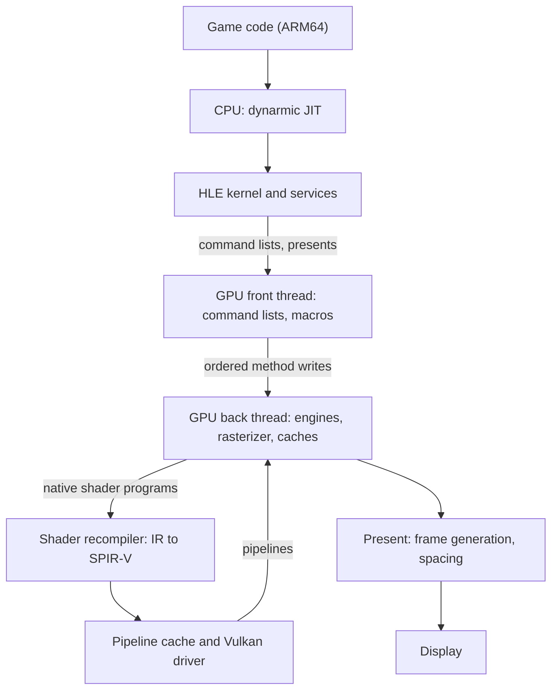

# Architecture

A map of Guarana for contributors and AI agents: what runs where, where this fork's changes live,
and how to check a change. It links to the deeper upstream documents instead of repeating them:

- [docs/DesignOverview.md](DesignOverview.md): high-level emulation and the source folders.
- [NX2_GPU_THREAD_SPLIT.md](../NX2_GPU_THREAD_SPLIT.md): why and how the GPU thread is split.
- [docs/nx2/debug-mcp.md](nx2/debug-mcp.md): the live debug server and its MCP adapter.
- [docs/lifecycle.md](lifecycle.md): what Guarana and its launcher store, and when each is
  flushed, loaded and preloaded; [docs/design/settings-hygiene.md](design/settings-hygiene.md) is
  the proposal ([#125](https://github.com/karimalsalah/guarana/issues/125)) to record who wrote each value and reset what the player did not choose.
- [docs/NvidiaGpu.md](NvidiaGpu.md) and [docs/nx2/amd.md](nx2/amd.md): the guest GPU, and how AMD
  drivers differ.

Rules for agents working in this tree are in [AGENTS.md](../AGENTS.md).

## The pipeline at a glance

Guarana is a high-level emulator: it runs the game's CPU code through a JIT and reimplements the
console's operating system services in C++, instead of emulating the hardware underneath them
([DesignOverview.md](DesignOverview.md)). Switch 2 games drive an NVIDIA GPU directly with command
lists and native shader programs; the emulator executes those commands and translates the shaders
to Vulkan.

## Source map

| Folder | What lives there | v20 hot spots |
|---|---|---|
| `src/core` | Kernel, services (`hle/service`, including `nvdrv` and `vi`), memory, loader, the debug server | `debugger/nx2_debug_server.cpp`, `debugger/nx2_debug_tools.cpp`, `nx2_power_session.h` |
| `src/dynarmic` | The ARM-to-x86-64 JIT ([docs](dynarmic/README.md)) | Upstream x86-64 code generation work |
| `src/video_core` | GPU emulation: command processing, engines, caches, renderers | `gpu_split.h`, `dma_pusher.cpp`, `frame_budget.cpp`, `shader_warm/`, `texture_cache/`, `buffer_cache/`, `query_cache/` |
| `src/video_core/renderer_vulkan` | The Vulkan backend: rasterizer, pipeline cache, presentation | `vk_pipeline_cache.cpp`, `renderer_vulkan.cpp`, `vk_present_manager.cpp`, `vk_ocarina_camera_motion.cpp`, `present/` |
| `src/shader_recompiler` | Native shader programs to IR to SPIR-V | `ir_opt/global_memory_to_storage_buffer_pass.cpp`, `backend/spirv/spirv_emit_context.cpp`, `profile.h` |
| `src/common` | Settings, logging, file paths, host helpers | `settings.h`, `power_policy.cpp`, `power_governor.cpp`, `power_meter.cpp`, `windows/crash_handler.cpp` |
| `src/lichii`, `src/qt_common` | The Qt frontend (`guarana.exe`; the folder keeps the upstream name) | `nx2_switches.h`, `configuration/configure_graphics.cpp`, `config/shared_translation.cpp` |
| `src/tests` | C++ unit tests (Catch2), built with `-DLICHII_TESTS=ON` | |
| `tools/bench` | Cross-machine benchmark and play launcher ([README](../tools/bench/README.md)) | New in v20 |
| `tools/nx2` | Debug MCP adapter, shader and cache tools, their Python tests | `debug_mcp.py`, `pipeline_stats.py` |

## A frame's path

1. **CPU.** Dynarmic translates the game's ARM64 code to x86-64 and runs it on guest core threads.
   System calls and service requests go to the HLE kernel and services in `src/core/hle`.
2. **Submission.** The game hands command lists to the GPU through the `nvdrv` service and presents
   finished frames through `vi`.
3. **GPU front thread.** Parses the command lists (`dma_pusher.cpp`), runs the game's GPU macros, and
   keeps copies of the registers those macros read. It waits for the back thread only where a command
   depends on the back's results.
4. **GPU back thread.** Executes the stream of method writes in order: the 3D, compute and copy
   engines, draws and dispatches, queries and fences, and the texture, buffer and query caches. Only
   the back thread touches the rasterizer. The split is on by default (`EDEN_NX2_SPLIT=2` in
   `dist/nx2_switches.txt`); the design and its measurements are in
   [NX2_GPU_THREAD_SPLIT.md](../NX2_GPU_THREAD_SPLIT.md).
5. **Shaders.** A draw whose programs the pipeline cache does not know yet sends them to the
   recompiler, which lowers the native program to IR, optimises it (`ir_opt/`) and emits SPIR-V
   (`backend/spirv/`). The Vulkan driver then compiles the pipeline; see
   [Shaders, caches and hitches](#shaders-caches-and-hitches).
6. **Present.** The renderer composites the game's framebuffer, adds generated frames when frame
   generation is on, and hands every frame to the present thread with the time it should stay on
   screen; see [Frame generation and pacing](#frame-generation-and-pacing).

## Where v20's own changes live

| Change | Switch | Files |
|---|---|---|
| Global-memory routing | `EDEN_NX2_GM=11` | `vk_pipeline_cache.cpp` (reads it), `shader_recompiler/profile.h`, `ir_opt/global_memory_to_storage_buffer_pass.cpp`, `backend/spirv/spirv_emit_context.cpp` |
| Extrapolated frame generation with HUD mask | `EDEN_NX2_EXTRAPOLATE=1` | `present/frame_gen.cpp`, `present/frame_extrapolation.cpp`, `present/extrapolation_source.h`, `host_shaders/frame_extrapolation.comp`, `vk_ocarina_camera_motion.cpp` |
| Present spacing for predicted frames | always on with frame generation | `renderer_vulkan.cpp`, `vk_present_manager.cpp` |
| Red/blue fix in generated frames | always on | `host_shaders/frame_extrapolation.comp` and its pipeline |
| iGPU power policy | `EDEN_NX2_POWER_POLICY=igpu` | `src/common/power_policy.cpp`, `src/common/power_governor.cpp`, `src/core/nx2_power_session.h` |
| Intel Arc fixes (Fritchii 0001, 0003, 0010) | always on | Vulkan dynamic state, shader recompiler shuffles, SPIR-V float atomics |
| Cross-machine benchmark | none | `tools/bench/` |

Everything else in v20 comes from upstream Lichii; the [changelog](../CHANGELOG.md) lists what was
merged early.

## Shaders, caches and hitches

A new pipeline costs a translation and a driver compile. The GPU back thread reads the shader
environments and translates the programs to IR itself; SPIR-V emission and the driver compile can
run on worker threads ([async-native-pipelines.md](nx2/async-native-pipelines.md)). A native draw is
never skipped, so it waits until its pipeline is built. On Intel's driver the compile alone takes
0.4-1 s per pipeline: that wait is the hitch on a first visit. Two caches make later visits cheap:
the emulator's persistent pipeline cache
(**Use persistent pipeline cache**) and the driver's own Vulkan pipeline cache
(**Use Vulkan pipeline cache**, in the advanced graphics settings). Moving translation off the GPU
thread, persisting SPIR-V, pipeline-library fast-link and warm-up are all on the
[roadmap](../ROADMAP.md#next).

To see where the time goes:

- `EDEN_NX2_STUTTER_TRACE=1` logs one `Nx2Stutter` line per slow frame with its top cause (for
  example a pipeline built on the GPU thread), a summary every 10 s, and `Nx2Boot` boot phases.
- `EDEN_NX2_PIPELINE_BUILD_TRACE=<file>` writes a `BEGIN`/`END` line per driver build with its wall
  time; the last `BEGIN` without an `END` names the shaders a driver crashed on.
- `EDEN_NX2_PIPELINE_STATS=<dir>` records what the driver's compiler made of each pipeline (spills,
  instruction counts, SIMD width where the driver reports them), and `tools/nx2/pipeline_stats.py`
  ranks the costliest. Such a session rebuilds everything, so do not time it.

### Global-memory routing (`EDEN_NX2_GM`)

Switch 2 shaders read and write memory through raw 64-bit addresses ("global memory"). A Vulkan
shader can only reach memory through bound buffers, so the storage-buffer pass maps each access to a
binding. Accesses it cannot resolve while translating stay global, and the generated SPIR-V finds the
right buffer at run time by comparing the address against the bound buffers. `EDEN_NX2_GM` makes that
run-time routing cheaper:

| Bit | Effect |
|---|---|
| 1 | Computes buffer base addresses once per invocation instead of in every access (programs that cannot change them) |
| 2 | A load searches only the pointer buffers its address is built from |
| 8 | With bit 2: when the address is in none of those buffers, returns zero instead of falling back to a search of every buffer |
| 4 | Reserved |

`EDEN_NX2_GM=11` sets bits 1, 2 and 8. In Ocarina of Time's Hyrule Field it cut the GPU time of the
foliage mesh draw from 15.7 to 5.8 ms on an Arc 140T. Bit 8 changes behaviour when an address falls
outside the buffers the pass expected, which is why the switch stays opt-in until more games and
devices have been checked.

## Frame generation and pacing

The settings live in **Emulation → Configure… → Graphics**: **Enable Frame Generation**,
**Frame Generation Type**, **Frame Generation Multiplier** (2 to 4) and **Target Frame Rate**. They
are `frame_gen*` in `src/common/settings.h`. Without a target, every real frame gets the multiplier's
count of generated frames. With a target, `frame_gen_pacer.cpp` chooses the count for each real
frame, up to 4x, to approach the target; at 20 game fps toward 60 that is 3x.

`present/frame_gen.cpp` decides, for every real frame, how many frames to generate
(`frame_gen_pacer.cpp`) and which generator runs:

- **Interpolation** (upstream): the `lsfg_*` passes or `fsr3_frame_gen.cpp` build frames between
  the previous and the current real frame, so the current real frame is shown after them.
- **Extrapolation** (Guarana, `EDEN_NX2_EXTRAPOLATE=1`, Ocarina of Time only): once a frame carries
  motion data, generated frames are predicted after the real frame instead.
  `vk_ocarina_camera_motion.cpp` provides a half-size guide image (motion to the previous frame and
  depth) when the game's temporal upscale ran or its anti-aliasing network was bypassed.
  `frame_extrapolation.comp` moves each pixel along that motion, lets a nearer surface moving over a
  pixel win, and falls back to nearby source pixels where something was uncovered. Without motion
  data or across a camera cut, the real frame is shown alone. HDR output pauses extrapolation,
  because the pass writes SDR.
- **HUD mask.** The renderer keeps the scene from before and after the game drew its HUD. Pixels
  where the two differ are HUD: they are copied as they are, and scene pixels never pull HUD pixels
  along.

**Spacing.** In `renderer_vulkan.cpp` every generated frame gets a `present_spacing`: an equal share
of the measured real frame interval. The present thread (`vk_present_manager.cpp`) holds each frame
for its spacing before it presents the next. With extrapolation, the real frame and each predicted
frame but the last hold one spacing; the last holds none, so the next real frame is shown as soon as
it is ready and the present queue cannot fall behind.

**The known gap.** Spacing follows the real frame interval, not the display's refresh. When the game's
rate does not divide the refresh rate (26.7-28 game fps against 60 Hz in Ocarina of Time), shown
frames land unevenly on refreshes: the micro-stutter listed in the known issues. The fix in progress
is a presenter locked to vblank (`EDEN_NX2_FLUID=1`, experimental), tracked as
[N1 in the roadmap](../ROADMAP.md#n1-vblank-locked-presenter-for-generated-frames).

## Power policy

`EDEN_NX2_POWER_POLICY=igpu` (Windows, integrated GPUs only, off by default) trades CPU power for GPU
headroom under a shared package power limit. At game boot it saves the active power plan's processor
performance boost mode and minimum processor state, turns boost off and lowers the minimum, and
writes the saved values back at game stop or exit. While the session runs, the saved values sit in
`nx2_power_restore.txt` in the config folder, so the next start restores them after a crash. A
governor adjusts how long the GPU threads busy-wait, based on GPU load and frame time. On a host that
is not an integrated GPU, nothing is changed. Details and the live `power` and `power_set` calls:
[debug-mcp.md](nx2/debug-mcp.md).

## Switches

Experiments and diagnostics are environment variables, nearly all `EDEN_NX2_*`, read once at start-up
unless the debug server changes them live. A GUI launch cannot set environment variables, so
`src/lichii/nx2_switches.h` loads `NAME=VALUE` lines from `nx2_switches.txt`:

1. the copy next to the program (shipped from `dist/nx2_switches.txt`; do not edit it);
2. the user copy, `%APPDATA%\guarana\nx2_switches.txt` (or `$XDG_CONFIG_HOME/guarana/` elsewhere),
   which wins over the shipped one;
3. a variable already set in the real environment wins over both.

A game's switch defaults (`ApplySwitchDefaults` in `src/core/game_presets.cpp`) replace a value
that only the shipped copy set, and keep every other one: `LoadNx2Switches` records which values
came from that copy alone (`src/common/switch_origin.h`).

The files accept `EDEN_NX2_*` and a short list of diagnostic names only. Restart after editing.
The registry of every switch, with its status and evidence, is [docs/switches.md](switches.md).

A switch is an experiment. The goal for each one is to graduate (on by default, switch removed) or to
be dropped, based on measured rows from more than one device.

## Debug server and MCP

`EDEN_NX2_DEBUG_SERVER=127.0.0.1:6545` starts a JSON-lines server inside the emulator, on loopback
only (other hosts are refused). `tools/nx2/debug_mcp.py` turns it into an MCP server over stdio, or
runs one request with `--call`. With it, an agent or a script can ask a running game for its
`status`, `frame_times`, a `screenshot`, `log_tail`, a `capture_frame`, `gpu_costs`, `memory` and
`power`, reject shaders live for a bisection, and send controller input (`input`,
`input_sequence`). The server is off unless the variable is set, and it has no way to read game
files, keys or firmware from disk. Everything else is in [debug-mcp.md](nx2/debug-mcp.md).

## Tests and CI

| What | How |
|---|---|
| C++ unit tests | Configure with `-DLICHII_TESTS=ON`, build, then `ctest --test-dir build --output-on-failure` |
| Benchmark tool | `python -I tools/bench/test_bench.py` (no emulator needed: fake debug server, fake command runner) |
| Debug adapter and shader tools | `python -I tools/nx2/test_debug_mcp.py`, and the other `tools/nx2/test_*.py` |
| Every pull request | `build-check.yml` builds and tests it; downloadable builds per PR are being added |

A passing test does not prove a game renders correctly. Say in your PR what you checked in a game,
and on which device, separately from the automated checks.

## Release builds

Windows x64 release builds use clang-cl with ThinLTO, PGO from a profile trained on Ocarina of Time
(`lichii-windows.profdata` in the repository root), and `x86-64-v3` code, so they need an AVX2 CPU.
For your own builds, start with [docs/Build.md](Build.md) and [docs/Options.md](Options.md).

## Working with upstream

Guarana tracks Lichii's `nx2` branch. Before writing a fix, check whether upstream already has one
(open and closed pull requests included) and port it with a citation instead of writing a second
version. A fix that is not specific to integrated GPUs or to this fork's switches goes back to Lichii
as a pull request too. [AGENTS.md](../AGENTS.md) has the steps. v20 merged ten upstream pull requests early and
ported three patches from [Fritchii-Intel-Fixes](https://github.com/LuckyLuckLucky/Fritchii-Intel-Fixes);
the [changelog](../CHANGELOG.md) lists them.
