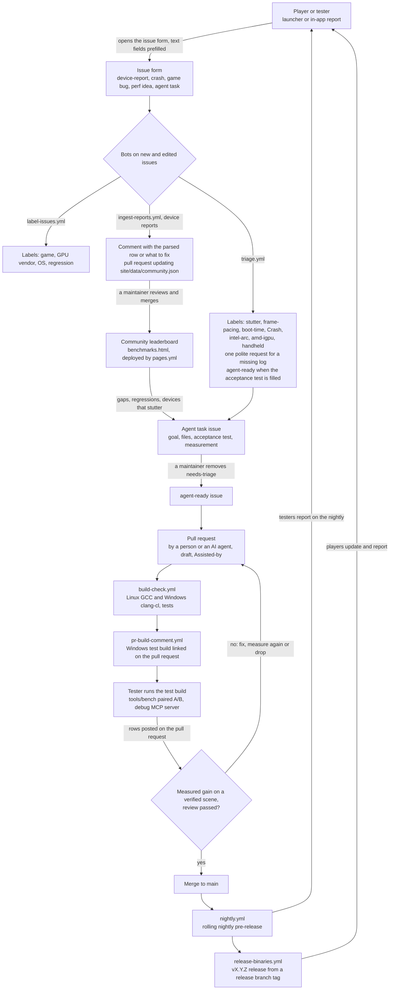

# The feedback loop

How a player's report becomes a measured fix in a release. Bots move data and label issues. People
review, test and merge. Nothing in this loop closes an issue, marks it stale or merges anything by
itself.



| Stage | What happens | Where | Who |
|---|---|---|---|
| Report | The player fills in an issue form, from the website, the launcher or the emulator | `.github/ISSUE_TEMPLATE/` | Player or tester |
| Triage | Topic and hardware labels, one log request for a crash without a log, `agent-ready` for a complete agent task | `.github/workflows/triage.yml`, `tools/ingest/triage.py`; `label-issues.yml` | Bot |
| Ingest | A device report is parsed, validated, scrubbed and normalised. It gets one comment with its row, and its row goes into the leaderboard's data pull request | `.github/workflows/ingest-reports.yml`, `tools/ingest/ingest.py` | Bot |
| Leaderboard | The merged data shows on the site, filterable by GPU vendor, form factor and game | `site/benchmarks.html#community`, `site/data/community.json`, `pages.yml` | Maintainer merges |
| Work | Gaps and problems become agent tasks; a maintainer confirms them | `agent-task.yml`, labels `agent-ready` and `needs-triage` | Maintainer |
| Fix | A person or an agent opens a pull request that proves the change with its acceptance test | [AGENTS.md](../AGENTS.md), [AGENTS-INVITE.md](AGENTS-INVITE.md), [AI_POLICY.md](AI_POLICY.md) | Contributor |
| Test build | CI builds and tests the pull request and links a Windows build in a comment | `build-check.yml`, `pr-build-comment.yml` | Bot |
| Measure | A tester with the hardware runs the test build: a paired A/B with `tools/bench`, questions through the debug MCP server | [tools/bench](../tools/bench/README.md), [debug-mcp.md](nx2/debug-mcp.md) | Tester |
| Ship | Merge to `main`, nightly pre-release, release from a release branch | `nightly.yml`, `release-binaries.yml`, [LANES.md](LANES.md) | Maintainer |

## 1. Reports

The [device report form](https://github.com/karimalsalah/guarana/issues/new?template=device-report.yml)
asks for the device, CPU, GPU, driver, RAM, OS, power, build, game, scene, settings and switches,
results, optional `tools/bench` rows and a screenshot. Crashes, game bugs, performance ideas and
agent tasks have their own forms.

**From the launcher or the emulator.** A report button opens the form in the browser with its text
fields filled in. GitHub fills the text fields of an issue form from URL query parameters, and a
field's `id` is its name there. See the
[form schema](https://docs.github.com/en/communities/using-templates-to-encourage-useful-issues-and-pull-requests/syntax-for-githubs-form-schema)
and
[creating an issue from a URL query](https://docs.github.com/en/issues/tracking-your-work-with-issues/using-issues/creating-an-issue#creating-an-issue-from-a-url-query):

```text
https://github.com/karimalsalah/guarana/issues/new?template=device-report.yml
    &title=[Device] ASUS ROG Ally X
    &device=ASUS ROG Ally X&cpu=AMD Ryzen Z1 Extreme&driver=32.0.21025.1024
    &ram=24 GB LPDDR5X-7500&os=Windows 11 24H2 (26100.4202)&power_mode=Turbo, 30 W
    &build=v20.0.2&scene=Hyrule Field, docked&settings=none
```

(one line, every value URL-encoded). The device report's field ids are `device`, `cpu`, `driver`,
`ram`, `os`, `power_mode`, `build`, `scene`, `settings`, `results`, `bench` and `notes`. Rules for
the sender:

- The person picks the dropdowns (form factor, graphics card, power source, game), ticks the two
  boxes, attaches the screenshot and presses Submit. GitHub documents prefilling for text fields
  only, and nothing is filed without the person seeing it.
- The URL never carries a user name, folder path, host name, serial number or account id.
- Keep the URL short. One over GitHub's server limit (not documented) gets `414 URI Too Long`.
  `tools/bench` rows are long: copy them to the clipboard and let the person paste them into the
  "tools/bench rows" field.
- Prefer `tools/bench` rows to typed numbers. They carry the scene check that earns the verified
  badge.

## 2. Triage (`triage.yml`)

Runs once per new issue, reads only the reporter's own words, and adds labels:

| Label | When |
|---|---|
| `stutter`, `frame-pacing`, `boot-time`, `Crash` | The title or the answers say so: "stutters", "uneven frame pacing", "takes 3 minutes to boot", "crashes". Negated mentions ("no crashes", "stutter-free") do not count, and neither do headings, pasted logs or code |
| `intel-arc`, `amd-igpu`, `handheld` | The "Graphics card" and "Form factor" answers, by the same tests as `label-issues.yml`. Without a specific GPU answer, device names in the text (Arc 140V, 780M, Steam Deck, ROG Ally) |
| `needs-info` and one comment | A crash reported without a log, through a bug form, a device report or an issue without a form. Agent tasks, performance ideas and feature requests that only mention a crash are not asked. The comment asks politely for `eden_log.txt`, says where it is and how to remove the user name from its paths, and asks for no dumps, keys or game files. `label-issues.yml` already asks when the crash form's log field is empty, so triage asks in every other case and the two never both comment |
| `agent-ready` | An agent task whose acceptance test says something checkable (not "n/a" or "tbd"), with a goal and files, and not marked Large. `needs-triage` stays until a maintainer removes it; agents take only issues without it |

It never removes a label, closes, locks or marks an issue stale.

## 3. Ingest (`ingest-reports.yml`)

Runs when an issue labelled `device-report` is opened, edited or gets that label, and by hand from
Actions > ingest-reports > Run workflow (with "dry run" to only print the result).

**publish** parses every `device-report` issue again with `tools/ingest/ingest.py`. Only one runs
at a time, and a newer queued run replaces an older one, which loses nothing because each run
rebuilds every record.

1. **Parse.** The answers of the form, and every JSON object in the "tools/bench rows" field or in
   any fenced `json` block.
2. **Choose the numbers.** A `tools/bench` row beats typed numbers. Of the rows, only those that
   are valid, are not probes, and pass `bench.py validate` (the check CI runs on contributed rows)
   count. Among those, the baseline variant wins, then rows without tracing switches, newest first.
   Only such a row sets `scene_ok: true`, the "verified scene" badge. If every row is invalid, the
   report stays off. Typed numbers are read from "Results": one fps figure, or a baseline and a
   result ("Baseline 14.8 fps, p99 96 ms. With EDEN_NX2_GM=11: 22.8 fps, p99 51 ms"), with p50 and
   p99 frame times. Lows, peaks and caps are not the result. Anything that reads more than one way
   is a problem to fix, never a guess.
3. **Validate.** Both boxes ticked, every required answer present, dropdown answers from the form,
   fps between 0.5 and 500, frame times in range, p99 not below p50. A typed measurement needs a
   screenshot.
4. **Normalise.** The GPU becomes vendor and type (integrated or discrete). The driver becomes a
   version (`32.0.101.9175`, `Adrenalin 25.9.1`, `Mesa 25.2.3`), and the build becomes `v20.0.2`,
   `nightly 2026-11-20 (1a2b3c4)` or `PR #123 test build (abc1234)`. The game gets its full title,
   and `EDEN_NX2_*` switches and frame generation are read from the settings.
5. **Scrub.** Only named fields are kept: no free notes, game file names, screenshots, logs or mod
   names, and no reporter login. Folder paths, links, e-mail and network addresses, host names,
   `@mentions` and serial numbers (by their label: "S/N", "serial", "service tag") are replaced,
   along with the reporter's login. Model numbers, driver versions and commit hashes stay.
6. **Write.** `site/data/community.json` holds one record per issue, keyed by its number, as one
   commit on top of the default branch on `bot/community-reports`, pushed with a lease. Its pull
   request is opened, updated, or closed when nothing is left to add. The pull request lists what
   changes and which reports are left out until they are fixed.

**comment** writes one comment on the report: the row it adds and where that row stands (on the
leaderboard, or in the pull request), or the list of problems. The comment is updated in place
when the report is edited.

**What maintainers do:**

- **Review and merge** the data pull request. Check that each new report's screenshot shows the
  scene it names and that the numbers are plausible for the device.
- **Start CI on it.** A pull request opened with the repository's token starts no workflows by
  itself: close and reopen it to run `build-check`, as for the upstream sync.
- **Drop a report.** Close its issue as not planned (or as a duplicate) or remove its
  `device-report` label, then run the workflow. Edit the issue, not the data file: the next run
  rewrites the file and the branch from the issues.
- **Check the settings.** Settings > Actions > General > Workflow permissions: "Allow GitHub
  Actions to create and approve pull requests" (also needed by `upstream-sync.yml`). Without it,
  the branch is still pushed and the run fails with that hint.

**Permissions:** only `GITHUB_TOKEN`, scoped per job: `publish` has contents and pull-requests write
and issues read; `comment` has issues write; `triage` has issues write. Issue text reaches the
scripts only through the event file and the API, never through `${{ }}` in a `run:` block.

## 4. The leaderboard

`site/benchmarks.html#community` renders `data/community.json` with a small inline script. No
libraries. Text goes into the page as text, and report links are built from the issue number. It
filters by GPU vendor, form factor, game and "verified scene only", and sorts by game fps, p99 frame
time, date or device. The "Verified scene" badge appears only on records with `scene_ok: true`.
Without JavaScript, the page links the data file. The maintainers' own measurements stay in the
tables above it (`data/benchmarks.json`).

## 5. From data to work

A maintainer turns what the leaderboard and the issues show into
[agent tasks](https://github.com/karimalsalah/guarana/issues/new?template=agent-task.yml). Examples:
a device class that stutters where others do not, a driver version that regresses, a game nobody
can boot. Each task needs a goal, the files, an acceptance test that fails before and passes after,
and the measurement that counts. Triage marks a complete one `agent-ready`, and removing
`needs-triage` releases it to people and agents
([AGENTS-INVITE.md](AGENTS-INVITE.md), [agents.json](../site/agents.json)).

## 6. Pull requests, test builds and measurement

- `build-check.yml` builds every pull request that changes code on Linux (GCC) and Windows
  (clang-cl) with warnings as errors, and runs the unit and Python tests.
  `pr-build-comment.yml` links the Windows build (`guarana-pr<N>-<commit>-windows-x86_64`, 14 days)
  in one comment on the pull request.
- A tester with the hardware runs that build. They run baseline and change back to back with
  `tools/bench` on a verified scene, and post the rows and the `bench.py compare` output. An agent
  helping them reads the running game through the debug MCP server, and never starts or stops the
  emulator.
- A performance change merges only with a measured gain on a verified scene. A switch that did not
  help is dropped, or stays off with its result in `docs/switches.md`.

## 7. Nightly and release

Merged changes reach players through `nightly.yml`: the rolling `nightly` pre-release, built when
`main` moved. Releases come from a `vX.Y.Z` tag on a release branch through
`release-binaries.yml` ([LANES.md](LANES.md)). Testers and players report on those builds, which
closes the loop.

## Working on the bots

```sh
python -I tools/ingest/ingest.py parse body.md --number 1      # what one issue body becomes
python -I -m unittest discover -s tools/ingest/tests -t tools/ingest/tests
```

The tests cover parsing, scrubbing, the publish flow against a local bare repository with a fake
GitHub API, triage, and structural checks of both workflows. Drift tests fail when the issue forms,
the label list, `label-issues.yml`, the bench row schema or the site files change under the parsers.
`ingest-reports.yml` runs them all on pull requests that touch the bots or anything they read. The
parser's own tests (`test_ingest.py`) also run before every publish; they hold whatever the data
file contains.
